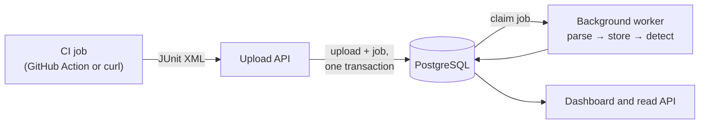

# Flakewatch

**Is that red build a real bug, or just a flaky test?**

Flakewatch collects test results from your CI, works out which failing tests are **flaky** (they
pass and fail on the same code) and which are **really broken**, and shows the evidence behind
every label.

**[Live demo →](https://flakewatch-latest.onrender.com/p/demo)** It runs on a free plan, so the
first visit after a quiet spell takes about a minute to wake up.


*The test page, with sample data: a test that is flaky only on Firefox, and the two runs that prove it.*

## Why

Flaky tests make CI noisy. A build goes red, someone re-runs it, it goes green, and everyone learns
to ignore red builds, including the ones that matter. At Google, about 1 in 6 tests showed some
flakiness, and most pass-to-fail changes involved a flaky test
([Google Testing Blog, 2016](https://testing.googleblog.com/2016/05/flaky-tests-at-google-and-how-we.html)).

The usual fixes are a spreadsheet, a gut feeling, or a paid tool. Flakewatch is a small,
self-hostable alternative that works with any CI producing JUnit XML.

## What it does

- **Collects** JUnit XML from GitHub Actions (one step), Jenkins, GitLab or anything that can run `curl`.
  It reads reports from Surefire, Gradle, TestNG, Playwright, WebdriverIO and jest-junit.
- **Labels each test** as Stable, Flaky, Suspected, Failing, Broken or "Not enough data", separately for each
  environment, such as Java 21 vs Java 25 or Chrome vs Firefox.
- **Only calls a test flaky with proof:** it failed and then passed on a retry, or it passed and
  failed on the same commit. The test page shows which runs prove it.
- **Groups similar failures**, so 40 identical timeouts read as one problem.
- **Never breaks your build.** If Flakewatch is down, the upload step prints a warning and your CI
  carries on.

## Use it in GitHub Actions

Add one step after your tests:

```yaml
- name: Upload test results to Flakewatch
  if: ${{ !cancelled() }}   # also run when tests failed: that's the point
  uses: Kuroh02/flakewatch/action@action-v1
  with:
    server-url: ${{ vars.FLAKEWATCH_URL }}
    token: ${{ secrets.FLAKEWATCH_INGEST_TOKEN }}
    files: '**/target/surefire-reports/TEST-*.xml'
```

Other CI systems: see [Upload from any CI](docs/guides/upload-from-any-ci.md). All the action's
options are in its [README](action/README.md).

## How it works



1. **CI uploads** its reports. The upload and a "process this" job are saved in one database
   transaction, so an accepted upload is never lost. Sending the same upload twice is safe: CI
   retries don't create duplicates.
2. **A background worker** claims the job, parses the XML, stores every attempt of every test, and
   groups failures by a fingerprint of their error message and stack trace.
3. **Detection** re-labels the affected tests from their recent history
   ([the exact rules](docs/design/detection-rules.md)).
4. **The dashboard** shows each run's failures as known-flaky, new or broken, with the evidence.

It's one Spring Boot service and one PostgreSQL database. The job queue is a database table, so
there's no message broker to run.

## Engineering notes

The parts most worth a look, with the reasoning written down in [decision records](docs/adr/README.md):

- **A job queue in PostgreSQL**, using `FOR UPDATE SKIP LOCKED`, leases with fencing tokens, retries
  with backoff, and a dead-letter state after 5 attempts ([ADR-0003](docs/adr/0003-postgres-job-queue.md)).
- **Evidence-based detection** as a pure function, tested with worked examples and property-based
  tests ([ADR-0004](docs/adr/0004-evidence-based-detection-rules.md),
  [ADR-0005](docs/adr/0005-property-testing-approach.md)).
- **A hardened XML parser** that rejects DTDs and external entities and enforces size limits. It is
  tested with real reports and with malicious ones (XXE, "billion laughs").
- **Contract-first API.** Every response in the integration tests is checked against
  [`api/openapi.yaml`](api/openapi.yaml), and the dashboard's TypeScript types are generated from it.
- **Deterministic tests.** Time and randomness are injected, so tests never sleep or depend on the
  clock.
- **CI on every pull request:** unit tests, integration tests against a real PostgreSQL
  (Testcontainers), dashboard tests, a container build that is started and smoke-tested, and a
  vulnerability scan. Merging to `main` deploys automatically and checks the new version is live.
- **It tracks itself.** Flakewatch's own CI uploads its results to the live site.

## Tech stack

Java 25 · Spring Boot 4 · PostgreSQL 17 · React 19 + TypeScript · GitHub Actions · Docker ·
Render + Neon (free tiers)

## Run it locally

You need Docker.

```bash
git clone https://github.com/Kuroh02/flakewatch && cd flakewatch
cp .env.example .env
docker compose up --build
# then open http://localhost:8080
```

Create a project and an upload token. The token is printed once:

```bash
docker compose run --rm app --flakewatch.bootstrap.project=demo --flakewatch.bootstrap.visibility=PUBLIC
```

Send it a real Surefire report from the test fixtures:

```bash
curl -H "Authorization: Bearer <the token>" \
  -F 'metadata={"commitSha":"3f2a9c1d","branch":"main","runId":"1"};type=application/json' \
  -F "files=@core/src/test/resources/fixtures/maven-surefire/TEST-sample.SampleTest.xml" \
  http://localhost:8080/api/v1/uploads
```

Open http://localhost:8080/p/demo. The `testFlaky` test is already marked **Flaky**, because it
failed and then passed when Surefire re-ran it.

## Run the tests

| What | Command |
|---|---|
| Java, unit and integration (needs Docker) | `./mvnw verify` |
| Core logic only, fast | `./mvnw -pl core test` |
| Dashboard | `npm --prefix web ci && npm --prefix web test` |
| GitHub Action | `npm --prefix action test` |

## Project layout

```
core/       pure Java: report parser, detection rules, failure fingerprints
server/     Spring Boot: upload API, job queue, read API; serves the dashboard
web/        React dashboard
action/     GitHub Action uploader (no dependencies)
api/        OpenAPI contract
examples/   the demo project, with deliberately flaky tests
docs/       design, decisions and planning documents
```

## Status and roadmap

**v0.1.0 (live, [release notes](CHANGELOG.md)):** uploads, detection, failure groups, the dashboard and the GitHub Action.

**Next, v1.0:** GitHub sign-in and self-service projects, then **quarantine**: a JUnit 5 extension
and a TestNG listener that stop known-flaky tests from failing builds while Flakewatch keeps
tracking them.

The full plan, requirements and design documents are listed in [docs/](docs/README.md).

## License

MIT
