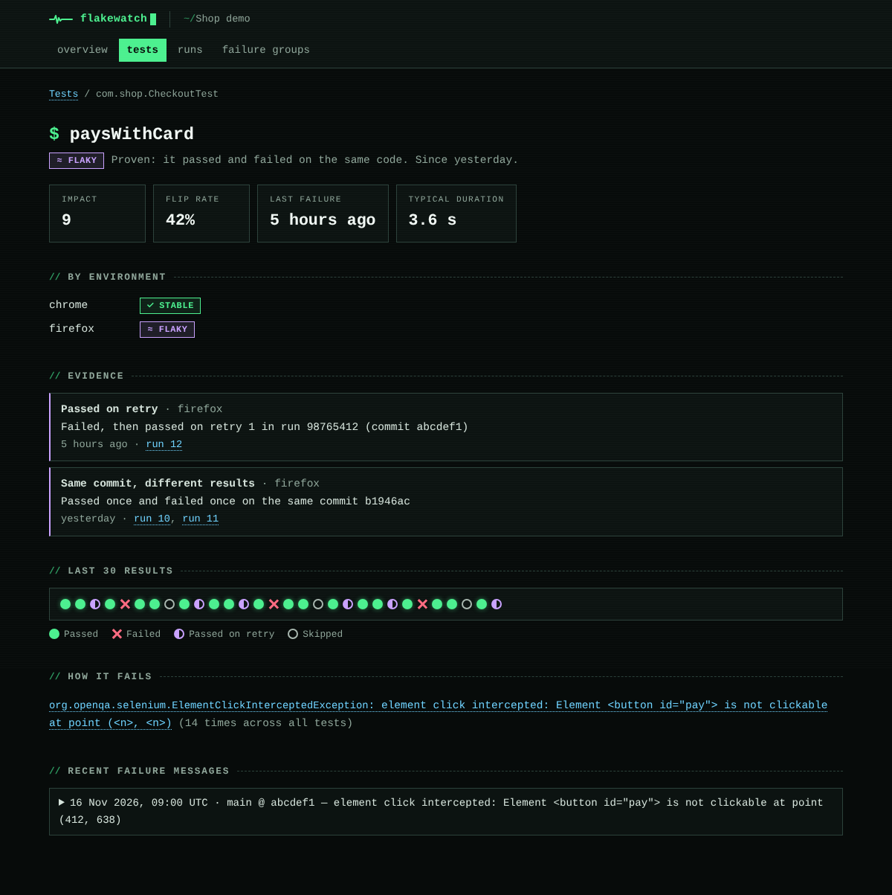

# Flakewatch

> **Is that red build real, or just a flaky test?** Flakewatch collects test results from CI, tells you which failures are **flaky** and which are **real**, and shows the **proof** for every claim.

**Status:** M1 (live demo) code is built and waiting for its first green CI run; going live is described in [docs/GO-LIVE.md](docs/GO-LIVE.md). *(Flakewatch is a working name.)*



*The test page, with sample data: flaky only on Firefox, with the two pieces of evidence that prove it.*

---

## What it does

- **Collects** JUnit XML from any CI (GitHub Action included; Jenkins and others via `curl`).
- **Detects** flaky tests from evidence: a test that failed and then passed on retry, or that passed and failed on the same commit.
- **Explains** every label: which runs, which commit, what happened.
- **Groups** similar failures, so 40 timeouts read as one problem.
- **Ranks** flaky tests by how much pain they cause.
- **Quarantines** flaky tests (JUnit and TestNG), so they stop breaking builds but keep being tracked.
- **Never breaks your build:** if Flakewatch is down, your CI behaves as if it weren't there.

## Read the docs in this order

| # | Document | What you'll learn | Time |
|---|---|---|---|
| 1 | [Constitution](docs/CONSTITUTION.md) | The rules this project never breaks | 10 min |
| 2 | [Spec](docs/SPEC.md) | What we're building and why: stories, requirements, success criteria | 20 min |
| 3 | [Detection rules](docs/design/detection-rules.md) | The heart of the product: exactly how a test gets its label | 15 min |
| 4 | [Plan](docs/PLAN.md) | How it's built: architecture, designs, testing, CI/CD, deployment | 45 min |
| 5 | [Tasks](docs/TASKS.md) | The ordered checklist to build v1 | 10 min |
| 6 | [Workflow](docs/WORKFLOW.md) | How work moves from idea to shipped code | 10 min |
| 7 | [Going live](docs/GO-LIVE.md) | From the repository to a public link, step by step | 10 min |

**Reference:**
[Glossary](docs/GLOSSARY.md) ·
[Data model](docs/design/data-model.md) ·
[API contract](api/openapi.yaml) ·
[Decision records](docs/adr/README.md) ·
[Templates](docs/templates/) ·
[First post-v1 feature](specs/001-ci-feedback/spec.md) ·
[Rules for AI assistants](AGENTS.md)

## Milestones

| Milestone | What's included | Phases |
|---|---|---|
| **M1: Live demo** | Upload, detection, failure groups, read-only dashboard, GitHub Action, live demo data | 0–4 |
| **M2: v1.0** | GitHub sign-in, projects and tokens, settings, quarantine (JUnit and TestNG) | 5–6 |
| **M3: v1.1** | Measured performance, faster cold start, PR comments and alerts, retrospective | 7 |

## Tech at a glance

Java 25 · Spring Boot 4 · PostgreSQL 17 · React 19 + TypeScript · Playwright · GitHub Actions · Docker · Render + Neon (free tiers)

## How it works

1. **CI uploads** its JUnit XML after the tests run: one step with the [GitHub Action](action/README.md), or [one `curl` command](docs/guides/upload-from-any-ci.md) anywhere else. The upload is saved together with a background job, in one transaction, so it can't be lost.
2. **A background job parses** the reports (Surefire, Gradle, TestNG, Playwright, WebdriverIO, jest-junit), stores every attempt of every test, and groups similar failures by fingerprint.
3. **Detection** decides each test's status from evidence, per environment ([the rules](docs/design/detection-rules.md)). A test is only called flaky when there's proof: it failed and then passed on a retry, or it passed and failed on the same commit.
4. **The dashboard** shows the result: which failures in a run are known flaky, new, or broken, and the proof behind every label.

Everything runs as one Spring Boot service with one PostgreSQL database. The job queue is a database table, so no message broker is needed.

## Repository layout

```
core/          pure-Java logic: report parser, detection rules, failure fingerprints
server/        Spring Boot service: upload API, job queue, read API; serves the dashboard
web/           React dashboard
action/        GitHub Action uploader (no dependencies)
api/           OpenAPI contract
examples/      a demo project with deliberately flaky tests, for the live demo
docs/  specs/  constitution, spec, plan, tasks, design, ADRs, guides, feature specs
```

Planned for later (M2 and M3): `quarantine/` (JUnit and TestNG libraries), `e2e/` and `perf/`.

## Running it locally

You need Docker.

```bash
git clone https://github.com/Kuroh02/flakewatch && cd flakewatch
cp .env.example .env
docker compose up --build
# open http://localhost:8080
```

Create a project and an upload token (the token is printed once):

```bash
docker compose run --rm app --flakewatch.bootstrap.project=demo --flakewatch.bootstrap.visibility=PUBLIC
```

Then send it a real report from the repository's test fixtures:

```bash
curl -H "Authorization: Bearer <the token>" \
  -F 'metadata={"commitSha":"3f2a9c1d","branch":"main","runId":"1"};type=application/json' \
  -F "files=@core/src/test/resources/fixtures/maven-surefire/TEST-sample.SampleTest.xml" \
  http://localhost:8080/api/v1/uploads
```

Open `http://localhost:8080/p/demo`. The `testFlaky` test is already marked **Flaky**, because Surefire's re-run passed after a failure.

## Running the tests

| What | Command |
|---|---|
| Java (unit and integration; needs Docker for PostgreSQL) | `./mvnw verify` |
| Core logic only, fast | `./mvnw -pl core test` |
| Dashboard | `npm --prefix web ci && npm --prefix web test` |
| GitHub Action | `npm --prefix action test` |

## Checking the docs

```bash
node scripts/check-docs.mjs            # requirements ↔ tasks, IDs, links (runs in CI)
node scripts/check-docs.mjs --strict   # also requires a test for every M1/M2 requirement (from M2)
```

## License

MIT
