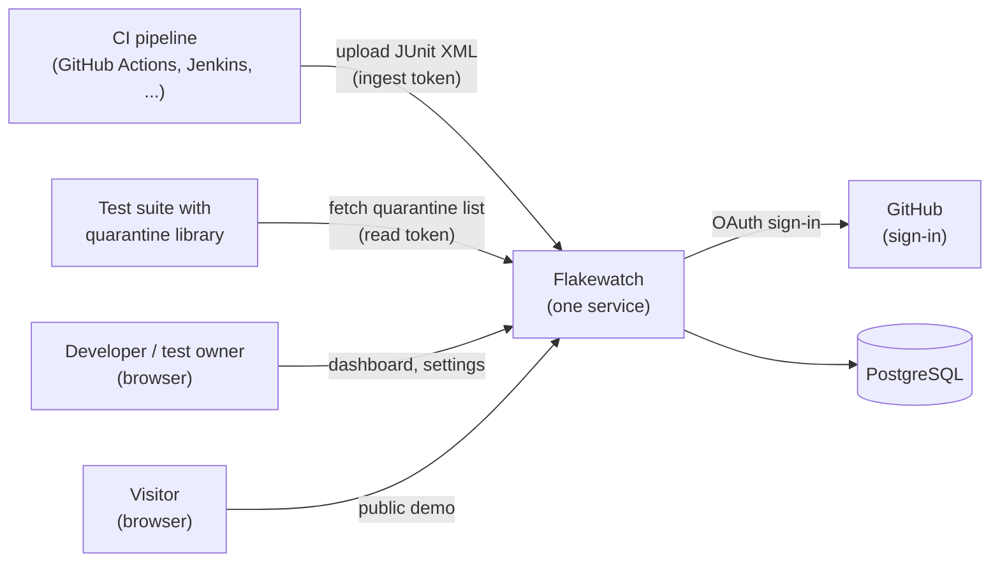
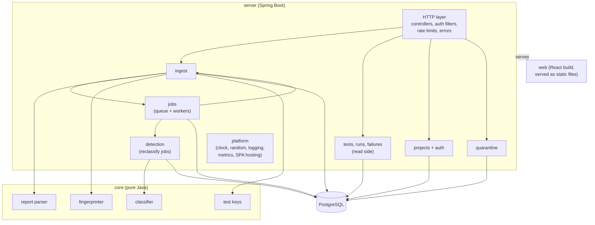
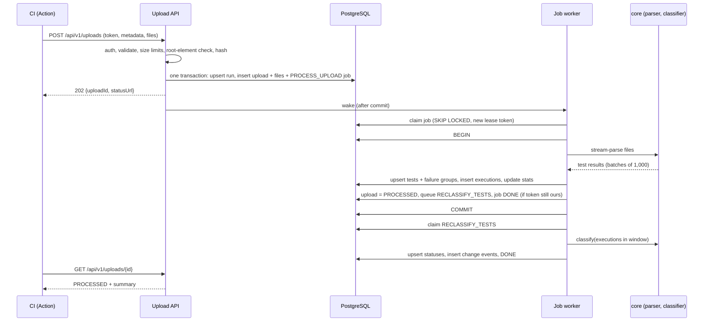
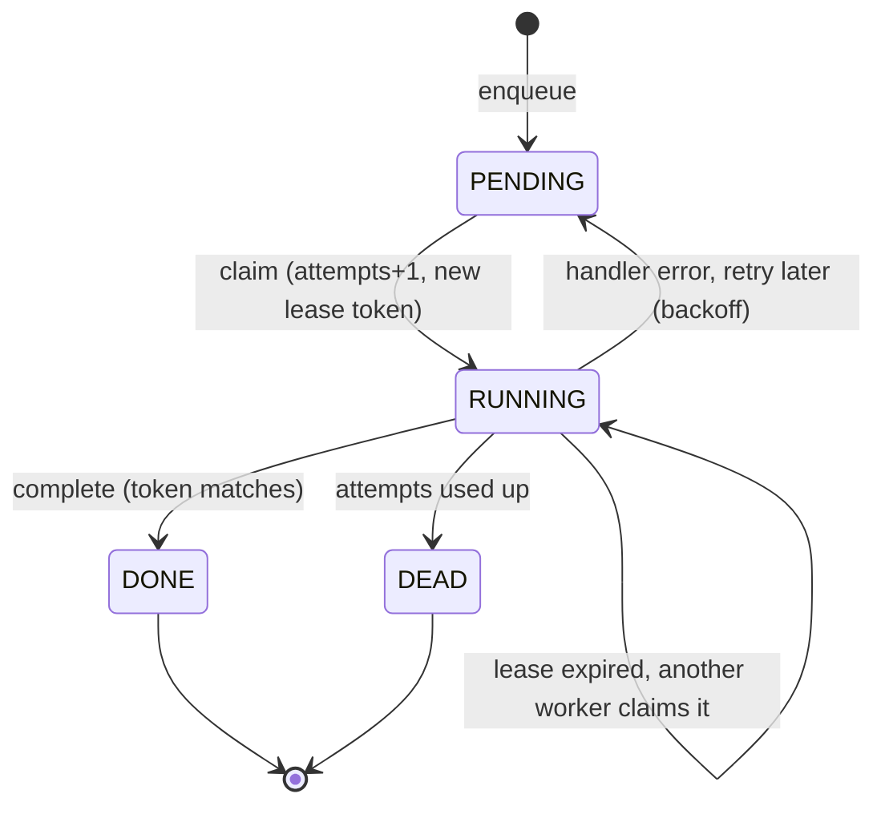

# Implementation Plan: Flakewatch v1

**Status:** Approved · **Plan version:** 1.0 · **Last updated:** 2026-11-13
**Implements:** [SPEC.md](SPEC.md) v1.0 · **Governed by:** [CONSTITUTION.md](CONSTITUTION.md) v1.0.0 · **Task list:** [TASKS.md](TASKS.md)

This document says **how** Flakewatch is built: architecture, key designs, testing, CI/CD, deployment, and the order of work. The **what** and **why** live in the spec. If this plan and the spec disagree, the spec wins, and this plan gets fixed.

---

## Contents

1. [Summary](#1-summary)
2. [Technology choices](#2-technology-choices)
3. [Constitution check](#3-constitution-check)
4. [Architecture](#4-architecture)
5. [Repository layout](#5-repository-layout)
6. [Module design](#6-module-design)
7. [Ingestion pipeline](#7-ingestion-pipeline)
8. [Background jobs](#8-background-jobs)
9. [Detection engine](#9-detection-engine)
10. [Failure fingerprinting](#10-failure-fingerprinting)
11. [Quarantine](#11-quarantine)
12. [HTTP API](#12-http-api)
13. [Web dashboard](#13-web-dashboard)
14. [GitHub Action uploader](#14-github-action-uploader)
15. [Security design](#15-security-design)
16. [Observability](#16-observability)
17. [Performance and cost budgets](#17-performance-and-cost-budgets)
18. [Testing strategy](#18-testing-strategy)
19. [CI/CD](#19-cicd)
20. [Configuration](#20-configuration)
21. [Deployment](#21-deployment)
22. [Delivery phases](#22-delivery-phases)
23. [Spikes](#23-spikes)
24. [Risks](#24-risks)
25. [Complexity and exceptions](#25-complexity-and-exceptions)
26. [Interview story map](#26-interview-story-map)

---

## 1. Summary

Flakewatch is **one Spring Boot service** backed by **one PostgreSQL database**. It also serves the React dashboard as static files.

- CI pipelines upload JUnit XML files.
- The service saves each upload and a background job in **one transaction**, replies `202`, and processes the files later.
- A **pure-Java core** (no Spring, no database) does the hard logic: parsing, flaky detection and failure fingerprinting. This keeps the logic fast to test, including with property-based tests and mutation testing.
- The background job queue is a **PostgreSQL table**, so no message broker is needed ([ADR-0003](adr/0003-postgres-job-queue.md)).
- Three small clients complete the picture:
  - a **GitHub Action** that uploads results,
  - a **JUnit extension** and a **TestNG listener** that apply quarantine.
- It deploys as a single Docker image to a free container host, with a free managed PostgreSQL ([ADR-0006](adr/0006-hosting-render-and-neon.md)).

## 2. Technology choices

Versions are as of November 2026. At the start of Phase 0, use the newest patch release of each, then let Dependabot keep them current. Full reasoning: [ADR-0007](adr/0007-tech-stack-baseline.md).

| Area | Choice | Notes |
|---|---|---|
| Language (backend) | **Java 25** (LTS) | Spring Boot 4 supports Java 17–25. |
| Framework | **Spring Boot 4.x** (4.1 today; 4.2 is expected in November 2026) | Boot 4 uses modular starters, e.g. `spring-boot-starter-webmvc`. Flyway needs `spring-boot-starter-flyway`. Each starter has a matching `-test` starter. |
| Build | **Maven** multi-module, with the Maven Wrapper | Familiar from Selenium/TestNG work. Surefire's rerun output feeds our own dogfooding. |
| Database | **PostgreSQL 17** | Use the same major version locally, in CI and in production. |
| Data access | **Spring `JdbcClient` + plain SQL** | No JPA. We need bulk upserts, `ON CONFLICT`, `FOR UPDATE SKIP LOCKED` and predictable queries. |
| Migrations | **Flyway** | Forward-only. |
| XML parsing | **StAX** (built into the JDK) | Streaming, so memory stays flat, and easy to harden. |
| Unit tests | **JUnit 6** (managed by Spring Boot 4) + **AssertJ** | |
| Property tests | **Small in-house helper** on JUnit 6 | See [ADR-0005](adr/0005-property-testing-approach.md). |
| Integration tests | **Testcontainers** (PostgreSQL module) with Spring Boot's `@ServiceConnection` | Real database, never an in-memory imitation. |
| API tests | **RestAssured** + OpenAPI validation filter (`swagger-request-validator`) | Confirm compatibility in spike S-6. |
| Architecture tests | **ArchUnit** | |
| Mutation tests | **PIT** (pitest) on `core` | Confirm JUnit 6 support in spike S-5. |
| Rate limiting | **Bucket4j** (in-memory) | Single instance, so no shared store needed. |
| Frontend | **React 19 + TypeScript (strict) + Vite** | |
| Frontend data | **TanStack Query** + **openapi-fetch**, with types from **openapi-typescript** | Types are generated from the contract, never hand-written. |
| Frontend tests | **Vitest** + **Testing Library** + **MSW** | |
| Charts | Hand-built SVG components | Just a timeline strip and a sparkline. One less dependency, and full control over accessibility. |
| E2E tests | **Playwright (TypeScript)** + `@axe-core/playwright` | |
| GitHub Action | **TypeScript**, `runs.using: node24`, bundled to `dist/` | GitHub is retiring Node 20 for actions; Node 24 is the default. |
| Quarantine libraries | Java, compiled with `--release 17` | So teams still on Java 17 can use them. |
| Load tests | **k6** | Scripts in JavaScript. |
| Container | Multi-stage Dockerfile, Temurin 25 JRE, non-root user | |
| Hosting | **Render** (free web service) + **Neon** (free PostgreSQL) | No credit card needed. See ADR-0006 for limits and fallbacks. |
| CI/CD | **GitHub Actions** | Jenkins is supported as a *client* (FR-CI-006). |

## 3. Constitution check

| Article | How this plan complies | Status |
|---|---|---|
| P1 Evidence over verdicts | Flaky requires stored evidence. A property test enforces it (PROP-DET-04). | ✅ |
| P2 Never break the user's build | The Action and the libraries fail open by default, and every client has unreachable-server tests. | ✅ |
| P3 Signal over noise | Events fire only on status changes. Lists are ranked by impact. | ✅ |
| 1 Spec first, traceable | Requirement IDs in tasks, tests and commits. `check-docs.mjs` runs in CI. | ✅ |
| 2 Tests first | Each phase's tasks list tests before code. Coverage and mutation gates. | ✅ |
| 3 Data correctness | Accept-and-enqueue in one transaction; idempotent inserts; fencing tokens; order-independent detection. | ✅ |
| 4 Simple by default | One service, one database, PostgreSQL as the queue. No broker, cache or second service. | ✅ |
| 5 Contract first | `api/openapi.yaml` is written in Phase 0, before any endpoint. | ✅ |
| 6 Secure by default | Hashed scoped tokens, hardened StAX, authorization matrix test, scanning in CI. | ✅ |
| 7 Deterministic | Injected `Clock` and `RandomSource`, ArchUnit bans, seeded property tests, pinned versions, dogfooding. | ✅ |
| 8 Observable | Structured logs, Micrometer metrics, split health checks, runbook. | ✅ |
| 9 Small steps | Walking skeleton deployed in Phase 0; every phase ends deployable; ADRs listed in section 25 and [adr/](adr/). | ✅ |

The slim M1 build (2026-11-16) records its exceptions and plan deviations in [section 25](#25-complexity-and-exceptions).

## 4. Architecture

### 4.1 Context



### 4.2 Inside the service



### 4.3 Upload, from request to status



### 4.4 Key design decisions

| Decision | Choice | ADR |
|---|---|---|
| Shape | Modular monolith with a pure-Java core | [0002](adr/0002-modular-monolith.md) |
| Background work | PostgreSQL table queue with leases and fencing tokens | [0003](adr/0003-postgres-job-queue.md) |
| Detection | Evidence-based rules with a fixed order | [0004](adr/0004-evidence-based-detection-rules.md) |
| Property tests | In-house seeded helper, not jqwik | [0005](adr/0005-property-testing-approach.md) |
| Hosting | Render + Neon free tiers, host-agnostic image | [0006](adr/0006-hosting-render-and-neon.md) |
| Stack | Java 25, Spring Boot 4, Maven, plain SQL | [0007](adr/0007-tech-stack-baseline.md) |
| Raw files | Stored in PostgreSQL for 7 days | [0008](adr/0008-raw-files-in-postgres.md) |
| Auth | GitHub sign-in for people, hashed project tokens for machines | [0009](adr/0009-authentication.md) |

## 5. Repository layout

One repository holds everything. The demo project is a separate repository (see [section 21.5](#215-demo-repository)).

```
flakewatch/
├── README.md  AGENTS.md  CLAUDE.md  CHANGELOG.md  LICENSE
├── pom.xml                      # Maven parent: Java 25, Spring Boot BOM, plugin versions
├── mvnw  .mvn/
├── core/                        # pure Java: parsing, detection, fingerprints, test keys
├── server/                      # Spring Boot app: API, jobs, persistence, serves web build
├── quarantine/
│   ├── quarantine-client/       # HTTP client, cache, config (Java 17 bytecode)
│   ├── quarantine-junit/        # JUnit Jupiter extension
│   └── quarantine-testng/       # TestNG listener
├── web/                         # React + TypeScript (Vite)
├── action/                      # GitHub Action (TypeScript, bundled to dist/)
├── e2e/                         # Playwright end-to-end and accessibility tests
├── perf/                        # k6 load tests + data seeding script
├── api/openapi.yaml             # the API contract
├── Dockerfile  compose.yaml     # one image; local stack with PostgreSQL
├── deploy/k8s/                  # optional showcase manifests (tested on kind)
├── tools/fixture-gen/           # tiny sample projects that produce real JUnit XML
├── scripts/                     # check-docs.mjs and dev helpers
├── docs/                        # constitution, spec, plan, tasks, design, ADRs, templates
├── specs/                       # per-feature folders (after v1)
└── .github/                     # workflows, PR and issue templates, dependabot.yml
```

The base Java package is `io.github.<you>.flakewatch`, written below as `…`. Using `io.github.<github-username>` keeps the option of publishing to Maven Central later.

## 6. Module design

### 6.1 `core`: the functional core

No Spring, no JDBC, no I/O beyond reading a given `InputStream`. Every function is deterministic.

| Package | Responsibility | Main types |
|---|---|---|
| `….core.report` | Streaming JUnit XML parser and its result model | `ReportParser`, `ParsedTestCase`, `ParsedExecution`, `ParseWarning`, `ParserLimits` |
| `….core.testkey` | Building and normalising test keys and method keys | `TestKeys` |
| `….core.fingerprint` | Normalising messages, filtering frames, hashing | `Fingerprinter`, `MessageNormalizer`, `FrameFilter` |
| `….core.detection` | The classifier from [detection-rules.md](design/detection-rules.md) | `Classifier`, `Execution`, `Classification`, `Evidence`, `DetectionSettings`, `Status` |

Test-only helpers (`Props`, generators and builders) are shared with `server` through a Maven `test-jar`.

### 6.2 `server`: the imperative shell

Packages are organised by feature, not by layer. Each feature exposes a small public API (a service and DTOs). Its repositories and internals stay in an `internal` sub-package.

| Package | Responsibility |
|---|---|
| `….ingest` | Upload endpoint, validation, idempotency, `ProcessUploadHandler` |
| `….runs` | Read API for runs and run detail |
| `….tests` | Read API for test cases, statuses, executions, trends |
| `….failures` | Failure groups: persistence and read API |
| `….detection` | `ReclassifyTestsHandler`, `ReclassifyAgingHandler`, status persistence, events |
| `….projects` | Projects, tokens, `ProjectAccess` (the single place that decides who may see what) |
| `….auth` | GitHub sign-in, token authentication filter, current-principal helpers |
| `….quarantine` | Quarantine API, ready-to-release logic (Phase 6) |
| `….jobs` | Queue repository, worker, handler registry, retention jobs |
| `….platform` | `Clock` and `RandomSource` beans, problem-details errors, request IDs, logging, rate limiting, SPA hosting, OpenAPI serving |

### 6.3 Architecture rules (enforced by ArchUnit, NFR-QUAL-002)

1. `core` depends on nothing from `server`, Spring or `java.sql`.
2. A feature package may use another feature's public types, never its `internal` package.
3. Controllers never call repositories directly.
4. Only `….platform.time` and `….platform.random` may call `Clock.systemUTC()`, `Instant.now()`, `LocalDate.now()`, `new Random()`, `Math.random()`, `UUID.randomUUID()` or `ThreadLocalRandom`.
5. Nothing logs a raw token. Token values are wrapped in a `Secret` type whose `toString()` is redacted.
6. No field injection. Constructor injection only.

## 7. Ingestion pipeline

Implements FR-ING-001 to FR-ING-013.

### 7.1 The request

`POST /api/v1/uploads` takes `multipart/form-data`:

- a `metadata` part (JSON, see `UploadMetadata` in the [contract](../api/openapi.yaml)),
- 1–20 `files` parts (`.xml` or `.xml.gz`).

Authentication: `Authorization: Bearer fw_ing_…`.

### 7.2 What happens synchronously

All of this happens before replying, and must take under 1 s (NFR-PERF-001):

1. **Authenticate** the token. Find the project and check the scope is `INGEST`. (Rate limit: [section 12.4](#124-rate-limits).)
2. **Validate metadata** with Bean Validation. Errors return `400`, listing every invalid field.
3. **Check limits** while streaming each file (see the table below). Gzip is decompressed through a counting stream that stops at the limit, which defeats zip bombs.
4. **Check the root element.** Read only until the first XML element. It must be `<testsuites>` or `<testsuite>`; otherwise return `400 not-a-junit-report`.
5. **Compute the content hash:** SHA-256 over the canonical metadata JSON (sorted keys) plus, for each file sorted by name, `name:sha256(decompressed bytes)`. Hashing the *decompressed* content means re-compressing the same file doesn't look like a different upload.
6. **Transaction:**
   1. Upsert `ci_runs` by `(project, provider, external_run_id, attempt)`. If the run exists with a different commit or branch, return `409 run-metadata-mismatch` (FR-ING-011).
   2. Insert into `uploads` with `on conflict (run_id, job_key) do nothing returning id`.
   3. If nothing was inserted, it's a duplicate. Load the existing upload: if the hash matches, return `200` with the original; if not, return `409 duplicate-upload-different-content` (FR-ING-004).
   4. Otherwise insert `upload_files` (gzip-compressed content) and a `PROCESS_UPLOAD` job with `dedupe_key = 'upload:' || id`.
7. **After commit,** signal the worker (see [section 8.4](#84-waking-up-without-polling)) and return `202` with `uploadId`, `status`, `statusUrl` and `runUrl`.

**Limits** (NFR-SEC-002), set in `ParserLimits` and server config:

| Limit | Value | Error |
|---|---|---|
| Request size | 50 MB | `413` |
| Files per upload | 20 | `400 too-many-files` |
| One file, as uploaded | 20 MB | `413` |
| One file, decompressed | 100 MB | `413` |
| All files, decompressed | 200 MB | `413` |
| Test cases per upload | 100,000 | Upload `FAILED` with reason |
| XML nesting depth | 64 | File error, reported in status |
| Attribute or text length | 64 KB | Trimmed, with a warning |
| Failure message stored | 4 KB | Trimmed |
| Stack trace stored | 16 KB | Trimmed |
| Test key | 2,000 characters | Trimmed, plus an 8-character hash suffix to stay unique |

### 7.3 Parsing rules

The parser is a StAX `XMLStreamReader` created by a hardened factory: `SUPPORT_DTD = false`, `IS_SUPPORTING_EXTERNAL_ENTITIES = false`, and no entity replacement. It emits results one test case at a time, so memory doesn't grow with file size.

| XML | Becomes |
|---|---|
| `<testcase>` with no result child | One `PASSED` execution |
| `<testcase>` + `<failure>` | One `FAILED` execution with type, message and stack trace |
| `<testcase>` + `<error>` | One `ERRORED` execution |
| `<testcase>` + `<skipped>` | One `SKIPPED` execution, **unless** its message starts with `[flakewatch:quarantined-failure]`: then a `FAILED` execution with `quarantined = true` (FR-ING-013) |
| `<testcase>` (passed) + N × `<flakyFailure>`/`<flakyError>` | N failed executions (index 0…N−1), then the final `PASSED` (index N). This is retry-pass evidence. |
| `<testcase>` + `<failure>` + N × `<rerunFailure>`/`<rerunError>` | The first failure (index 0), then N more failures. The final outcome is failed; this is not evidence. |
| The same test key appearing again in one upload | Further executions, in order: files sorted by name, then position in the file |
| `time="1.234"` | 1,234 ms. Thousands separators are stripped. Invalid or missing values become 0, with a warning. |
| Missing `classname` | Use the parent `<testsuite name>`. If that is missing too, `(unknown)`, with a warning. |
| A malformed `<testcase>` | Skipped, with a warning naming the file and line (FR-ING-009) |
| A file that isn't well-formed XML | The upload is `FAILED` with "file X, line Y: …" (FR-ING-008) |

The exact quirks of each producer come from the **real fixtures** captured in spike S-1. Every fixture has a matching expected-result JSON file, and a test compares parser output against it (an "approval test").

### 7.4 What happens in the background (`PROCESS_UPLOAD`)

1. In a short transaction, set the upload to `PROCESSING`, so the status endpoint shows progress.
2. In **one transaction**, for each batch of 1,000 parsed test cases:
   1. Build test keys and method keys (`core.testkey`).
   2. Upsert `test_cases` with `insert … on conflict (project_id, key_hash) do update set last_seen_at = greatest(…) returning id`.
   3. Fingerprint failures (`core.fingerprint`), then upsert `failure_groups`.
   4. Insert `test_executions` with `on conflict do nothing returning …`.
   5. From the rows **actually inserted** (never from the input), add to `test_daily_stats` and `failure_groups.occurrences`.
3. In the same transaction:
   1. Set the upload to `PROCESSED`, with its summary and warnings.
   2. Queue `RECLASSIFY_TESTS` for the tests selected by the rule in [detection-rules.md §11](design/detection-rules.md#11-when-statuses-are-recalculated).
   3. Mark the job `DONE`, guarded by its fencing token.
4. If the job finally fails (`DEAD`), a separate transaction sets the upload to `FAILED` with a readable reason (NFR-REL-001).

**Why one big transaction?** It gives *effectively-once* processing (NFR-REL-002) with no extra bookkeeping. A crash means a full rollback. A second run inserts nothing new, so it counts nothing. A 10,000-test upload is a few seconds of work, which is fine for one transaction.

## 8. Background jobs

Implements NFR-REL-001 to NFR-REL-003 and NFR-COST-001. Decision record: [ADR-0003](adr/0003-postgres-job-queue.md).

### 8.1 Job kinds

| Kind | Queued by | Does |
|---|---|---|
| `PROCESS_UPLOAD` | Upload API | Parse and store results ([section 7.4](#74-what-happens-in-the-background-process_upload)) |
| `RECLASSIFY_TESTS` | `PROCESS_UPLOAD` | Recompute statuses for the given test IDs |
| `RECLASSIFY_PROJECT` | Settings change | Recompute every test in a project, in batches |
| `RECLASSIFY_AGING` | Daily scheduler | Same as above for every project, then write `project_daily_snapshots` |
| `PURGE_RAW_FILES` | Daily scheduler | Null out raw files older than 7 days |
| `PURGE_OLD_DATA` | Daily scheduler | Delete expired executions, statistics and finished jobs, in batches |

Daily jobs use a `dedupe_key` such as `aging:2026-11-13`. If the scheduler fires twice, or two instances run during a deploy, the job is still queued only once.

### 8.2 Lifecycle



### 8.3 The SQL that makes it safe

**Claim** (a short transaction of its own):

```sql
with next as (
  select id from jobs
  where (status = 'PENDING' and run_after <= :now)
     or (status = 'RUNNING' and lease_expires_at <= :now)
  order by run_after, id
  limit 1
  for update skip locked          -- two workers never grab the same row
)
update jobs j
   set status = 'RUNNING',
       attempts = j.attempts + 1,
       lease_token = :newToken,   -- the fencing token
       lease_expires_at = :now + make_interval(secs => :leaseSeconds),
       updated_at = :now
  from next
 where j.id = next.id
returning j.*;
```

If `attempts > max_attempts` after a claim, the worker marks the job `DEAD` straight away, without running it. A job that keeps crashing the process ("poison pill") therefore stops after 5 tries.

**Complete** (the last statement inside the handler's transaction):

```sql
update jobs set status = 'DONE', finished_at = :now, updated_at = :now, lease_token = null
 where id = :id and lease_token = :token and status = 'RUNNING';
-- If 0 rows changed, someone else owns this job now: throw LeaseLostException and roll back everything.
```

**Fail** (in a new transaction, after the handler's transaction rolled back):

```sql
update jobs
   set status = case when attempts >= max_attempts then 'DEAD' else 'PENDING' end,
       run_after = :now + make_interval(secs => :backoffSeconds),
       last_error = :error, lease_token = null, lease_expires_at = null, updated_at = :now
 where id = :id and lease_token = :token;
```

Settings:

| Setting | Value |
|---|---|
| Backoff | 30 s × 2^(attempts−1), at most 1 hour, ±20% jitter (from the injected `RandomSource`) |
| Lease | 5 minutes. Every v1 job finishes well within it. |
| Workers | 2 threads by default (`FLAKEWATCH_WORKERS`) |

### 8.4 Waking up without polling

Neon's free database sleeps after 5 minutes without activity, and has a monthly compute budget (100 CU-hours per project). A worker that polls every second would keep it awake around the clock and use up that budget. So the worker **sleeps until it has a reason to wake**:

1. **Signal:** after an upload's transaction commits (`TransactionSynchronization.afterCommit`), the API wakes a worker straight away.
2. **Timer:** after an empty claim, the worker asks for the next due time: `min(run_after)` of pending jobs and `min(lease_expires_at)` of running ones. It sleeps until then, but **at most 10 minutes**.
3. **Startup:** one claim attempt at boot, to pick up anything left from before a restart or sleep.

This keeps the database quiet when nobody is uploading, while retries still run on time.

### 8.5 Shutdown and host sleep

- Spring's graceful shutdown (`server.shutdown=graceful`, 30 s timeout) stops new claims and lets running jobs finish.
- If a job is still running after 25 s, it is interrupted. Its transaction rolls back, and its lease is released in a final short transaction, so it is picked up immediately after restart (NFR-REL-003).
- If the host kills the process without warning (free hosts sleep), the lease simply expires and the next worker reclaims the job. This is tested by killing a worker mid-job in an integration test.

## 9. Detection engine

Implements FR-DET-001 to FR-DET-012. **The full specification is [design/detection-rules.md](design/detection-rules.md).** This section only covers how it is wired up.

- `Classifier.classify(executions, settings, now, defaultBranch)` is a pure function in `core`.
- `ReclassifyTestsHandler` (in `server`):
  1. Loads, for the given test IDs, executions in the window (at most 200 per variant), joined with run and upload fields, using one query per batch of 500 tests.
  2. Calls the classifier.
  3. Compares the result with the stored `test_status`.
  4. Upserts the status, and inserts a `test_status_events` row for each change.
- The worked examples E01–E17 are a parameterised test. The properties PROP-DET-01 to PROP-DET-11 are property tests.
- Project settings live in `projects.settings` (JSON) and are validated against the allowed ranges. Changing them queues `RECLASSIFY_PROJECT`.

## 10. Failure fingerprinting

Implements FR-GRP-001 to FR-GRP-003.

```
fingerprint = SHA-256( failureType + "\n" + normalise(firstLineOfMessage) + "\n" + join(topFrames(3), "\n") )
```

**Failure type:** the `type` attribute. If it's missing, the exception class at the start of the stack trace. If that's missing too, `"(none)"`.

**Normalising the message** (applied in this order, then whitespace collapsed and trimmed to 500 characters):

| Pattern | Replaced with |
|---|---|
| UUIDs | `<uuid>` |
| ISO-8601 dates and times, `HH:mm:ss(.SSS)` | `<time>` |
| Hex strings of 8+ characters, `0x…` values | `<hex>` |
| Temp and home paths (`/tmp/…`, `/var/folders/…`, `C:\Users\…\AppData\Local\Temp\…`) | `<path>` |
| Numbers, with optional units (`3012ms`, `1.5s`, `8080`) | `<n>` |

**Top frames:**

1. Parse Java frames (`at a.b.C.method(File.java:12)`) and JavaScript frames (`at fn (file.ts:12:5)`).
2. Drop line and column numbers, which change with every edit.
3. Drop framework frames: `java.`, `jdk.`, `sun.`, `org.junit.`, `org.testng.`, `org.springframework.test.`, `org.apache.maven.`, `org.gradle.`, `org.opentest4j.`, `node:internal`, `node_modules/`.
4. Keep the first 3 remaining frames.

Properties (PROP-FP):

| ID | Property |
|---|---|
| PROP-FP-01 | Normalising twice gives the same result as normalising once. |
| PROP-FP-02 | Messages that differ only in digits share a fingerprint. |
| PROP-FP-03 | Frames that differ only in line numbers share a fingerprint. |
| PROP-FP-04 | Different failure types never share a fingerprint, for the same message. |
| PROP-FP-05 | Fingerprints are stable across JVMs and locales. A fixed list of known input/output pairs is checked in. |

## 11. Quarantine

Implements FR-QUA-001 to FR-QUA-006 and FR-ING-013. Built in Phase 6.

### 11.1 Server

- `POST /api/v1/projects/{slug}/quarantine` with `{methodKey, reason}` quarantines a test; `DELETE /api/v1/projects/{slug}/quarantine/{id}` releases it. Owner only.
- `GET /api/v1/projects/{slug}/quarantine` returns the active list. It accepts a read token or the owner's session, and supports `ETag` / `If-None-Match` → `304`.
- **Ready to release:** the test's last 20 final outcomes (all variants) are passes, and they span at least 3 different calendar days (UTC). This is computed while reclassifying and stored in `test_status.evidence`-style JSON for display.
- Executions are marked `quarantined = true` at ingest when their method key is in the active list at that moment.

### 11.2 Client libraries

All three share one design:

```
quarantine-client
  ├─ reads config from environment variables:
  │    FLAKEWATCH_URL, FLAKEWATCH_PROJECT, FLAKEWATCH_READ_TOKEN,
  │    FLAKEWATCH_QUARANTINE_MODE = MUTE (default) | SKIP | OFF
  ├─ fetches the list once per JVM (lazy, thread-safe), 3 s timeout
  ├─ caches it to target/flakewatch-quarantine.json with its ETag
  └─ FAIL-OPEN: any error → empty list + one warning line (FR-QUA-005)
```

| Library | Mechanism | MUTE mode | SKIP mode |
|---|---|---|---|
| `quarantine-junit` (JUnit Jupiter) | Extension, auto-registered through `META-INF/services` (needs `junit.jupiter.extensions.autodetection.enabled=true`) or `@ExtendWith` | A `TestExecutionExceptionHandler` turns a failure of a quarantined test into a `TestAbortedException` whose message starts with `[flakewatch:quarantined-failure]`, followed by the original failure. Reports show it as skipped, and the build stays green. | An `ExecutionCondition` disables the test, with the reason |
| `quarantine-testng` | `IInvokedMethodListener`, auto-registered through `META-INF/services` | In `afterInvocation`, a failed quarantined test has its result set to `SKIP`, with a `SkipException` carrying the same marker | In `beforeInvocation`, throw `SkipException` |

**Matching:** the library builds the method key exactly as `core.testkey` does (`className#methodName`). The shared rules are copied into the client module with a test that checks both produce the same keys for the fixture set (spike S-4). This avoids a dependency from the client on `core`.

**Compatibility:** CI runs the libraries' tests against JUnit Jupiter 5.10, 5.14 and 6.x, and TestNG 7.10+. Tests use the JUnit Platform `EngineTestKit` and TestNG's programmatic runner, to assert exactly what the reports would show.

## 12. HTTP API

The contract is **[api/openapi.yaml](../api/openapi.yaml)** (OpenAPI 3.0.3). Change it first ([Constitution Article 5](CONSTITUTION.md#article-5-the-api-contract-comes-first)).

### 12.1 Conventions

| Topic | Rule |
|---|---|
| Base path | `/api/v1`. A breaking change means `/api/v2`. Adding fields or endpoints is not breaking. |
| Format | JSON, camelCase. Times are ISO-8601 UTC strings. |
| Errors | `application/problem+json` (RFC 9457), with an extra `code` field (e.g. `duplicate-upload-different-content`) and, for validation errors, `errors[]` listing each field. |
| Pagination | Cursor-based: `?limit=50&cursor=…` → `{items, nextCursor}`. The maximum limit is 100. Cursors are opaque (base64 of the sort key and the last ID). |
| IDs | Projects are addressed by slug. Everything else by numeric ID, always within a project path. |
| Not found vs forbidden | A private project you can't see returns `404`, never `403`, so its existence isn't revealed (FR-PRJ-004). |
| Caching | `Cache-Control: no-store` for private data. Public reads get a short `max-age`. ETags for the quarantine list. |

### 12.2 Endpoint groups

| Group | Endpoints | Callers |
|---|---|---|
| Ingestion | `POST /uploads`, `GET /uploads/{id}` | Ingest token; owner session for `GET` |
| Projects | `GET /projects`, `POST /projects`, `GET/PATCH/DELETE /projects/{slug}` | Session; public projects readable by anyone |
| Tokens | `GET/POST /projects/{slug}/tokens`, `DELETE /projects/{slug}/tokens/{id}` | Owner session |
| Dashboard reads | `…/summary`, `…/tests`, `…/tests/{id}`, `…/tests/{id}/executions`, `…/runs`, `…/runs/{id}`, `…/failure-groups`, `…/failure-groups/{id}` | Anyone for public projects; owner for private |
| Quarantine | `GET/POST …/quarantine`, `DELETE …/quarantine/{id}` | Read token or owner (GET); owner (POST, DELETE) |
| Account | `GET /me` | Session |
| Meta | `GET /version` | Anyone (the deploy smoke test checks the git SHA) |

Sign-in uses Spring Security's standard `/oauth2/authorization/github` and `/logout` endpoints, which sit outside the contract.

### 12.3 Who can call what

`ProjectAccess` is the only component that decides access. Each operation states the access it needs:

| Need | Anonymous | Signed in, not owner | Owner | Ingest token (same project) | Read token (same project) | Any token, other project |
|---|---|---|---|---|---|---|
| Read a public project | ✅ | ✅ | ✅ | ❌ | ❌ | ❌ |
| Read a private project | 404 | 404 | ✅ | ❌ | ❌ | 404 |
| Upload | 401 | 401 | 401 | ✅ | 403 | n/a: the project comes from the token |
| Read quarantine list | public only | public only | ✅ | 403 | ✅ | 404 |
| Change project, tokens, quarantine | 401 | 404 / 403* | ✅ | 403 | 403 | 404 |

\* `404` for private projects, `403` for public ones.

This table is turned directly into the **authorization matrix test** (NFR-SEC-003). The test reads every operation from `openapi.yaml` and fails if any operation has no entry in the matrix. A new endpoint therefore can't ship without authorization tests.

### 12.4 Rate limits

| Bucket | Limit | Response |
|---|---|---|
| Uploads, per token | 60 per minute, burst of 20 | `429` with `Retry-After` |
| Public reads, per IP | 120 per minute | `429` with `Retry-After` |
| Sign-in attempts, per IP | 20 per minute | `429` |

## 13. Web dashboard

Implements FR-UI-001 to FR-UI-008 and NFR-A11Y-001.

### 13.1 Pages

| Route | Page | Milestone |
|---|---|---|
| `/` | Home: public demo projects, sign-in button, my projects | M1 (sign-in in M2) |
| `/p/:slug` | Overview: counts per status, 30-day flaky trend, recent runs | M1 |
| `/p/:slug/tests?status=&q=&sort=` | Tests list | M1 |
| `/p/:slug/tests/:testId` | Test detail: per-variant status, timeline, evidence, failure groups, durations | M1 |
| `/p/:slug/runs`, `/p/:slug/runs/:runId` | Runs list and run detail, with labelled failures | M1 |
| `/p/:slug/failures`, `/p/:slug/failures/:groupId` | Failure groups | M1 |
| `/p/:slug/quarantine` | Quarantined tests, ready-to-release hints | M2 |
| `/p/:slug/settings` | Tokens, detection settings, visibility, delete | M2 |
| `/projects/new` | Create project | M2 |

### 13.2 How it's built

- **State lives in the URL** (filters, sort, cursor), so every view can be shared and survives a reload (FR-UI-007).
- **Server data comes through TanStack Query**, with generated types. No global state library.
- **Every page has three non-happy states**, each a shared component: loading skeleton, empty state (with a hint such as "No flaky tests 🎉 — here's how detection works"), and error with retry.
- **Status badges** always combine an icon, text and colour. The timeline strip uses shape as well as colour (● pass, ✕ fail, ◐ passed on retry, ○ skipped). Each chart has a visually hidden data table for screen readers.
- **Styling:** CSS modules plus a small set of CSS variables (colours, spacing, type scale), with a dark mode. No component library.

## 14. GitHub Action uploader

Implements FR-CI-001 to FR-CI-005.

**Usage:**

```yaml
- name: Upload test results to Flakewatch
  if: ${{ !cancelled() }}          # run even when tests failed: that's the point
  uses: <you>/flakewatch/action@v1
  with:
    server-url: https://flakewatch.example.com
    token: ${{ secrets.FLAKEWATCH_INGEST_TOKEN }}
    files: '**/target/surefire-reports/TEST-*.xml'
    variant: ${{ matrix.browser }}  # optional
    job-key: ${{ github.job }}-${{ strategy.job-index }}  # needed for matrix jobs
```

**Inputs:**

| Input | Default | Purpose |
|---|---|---|
| `server-url` | (required) | Flakewatch base URL |
| `token` | (required) | Ingest token. If empty, skip with a notice (FR-CI-004). |
| `files` | `**/TEST-*.xml` | Glob(s), one per line |
| `job-key` | `${GITHUB_JOB}` | Unique per job and shard |
| `variant` | empty | Environment label |
| `fail-on-error` | `false` | Opt in to failing the step (FR-CI-002) |
| `timeout-seconds` | `120` | Total time budget, including a sleeping host waking up |

**Metadata it fills in automatically:**

| Field | Source |
|---|---|
| Commit | `GITHUB_SHA`. For `pull_request` events this is GitHub's temporary merge commit. We use it on purpose: that's the code that actually ran, and it stays the same when a run is re-run. |
| Branch | `GITHUB_HEAD_REF` for pull requests, otherwise `GITHUB_REF_NAME` |
| Run ID and attempt | `GITHUB_RUN_ID`, `GITHUB_RUN_ATTEMPT` |
| Pull request number | From the event payload |
| Repository URL | `GITHUB_SERVER_URL` + `GITHUB_REPOSITORY` |

**Behaviour:**

1. Find files. If there are none, log a warning and finish successfully.
2. Gzip them in memory and build a multipart request with Node's built-in `fetch`, `FormData` and `Blob`.
3. Retry up to 3 times on network errors, `429` and `5xx`, with backoff of 2 s, then 8 s, then 30 s. Respect `Retry-After`. Stop when the time budget runs out.
4. On success, write a job summary: counts and a link to the run.
5. On final failure, log `::warning::`, and fail the step only if `fail-on-error` is `true`.
6. Never print the token. Register it with `core.setSecret` so the runner masks it in logs.

**Packaging:**

- The action lives in `action/`, with `action.yml` (`runs.using: node24`) and a bundled `dist/index.js`.
- CI fails if `dist/` is out of date.
- Releases are tagged `action-v1.x.y`, and a moving `action-v1` tag points at the latest.

For Jenkins and other CI systems, `docs/guides/upload-from-any-ci.md` shows the equivalent `curl` command and a `Jenkinsfile` example (FR-CI-006).

## 15. Security design

Implements NFR-SEC-001 to NFR-SEC-006.

| Threat | Mitigation | Proven by |
|---|---|---|
| Stolen ingest token | Per project, upload-only, revocable, last-used time shown, rate-limited | Scope and revocation tests |
| Reading another project's data (IDOR) | Every query is scoped by a project ID that comes from `ProjectAccess`, never straight from the request | Authorization matrix test |
| XXE or entity-expansion ("billion laughs") | DTDs and external entities disabled in StAX | Malicious-fixture tests |
| Zip bomb, huge files | Counting streams with hard limits; request size limits | Malicious-fixture tests |
| Deep nesting, huge attributes | Depth and length limits in the parser | Generated-input tests |
| Cross-site request forgery | Spring Security CSRF on session-cookie requests (cookie-to-header for the SPA); token endpoints are stateless and exempt | CSRF tests |
| Cross-site scripting via test names or messages | React escapes everything; `dangerouslySetInnerHTML` is banned by a lint rule; strict CSP | Lint rule, an E2E test with a `<script>` test name |
| Token leaks | Shown once, stored hashed, `Secret` wrapper, log redaction filter, `fw_ing_`/`fw_read_` prefixes to make leaks easy to spot | Log-capture test |
| Session theft | Secure, HttpOnly, SameSite=Lax cookies; HSTS | Header tests |
| Abuse and denial of service | Rate limits, pagination caps, request limits | Rate-limit tests |
| Vulnerable dependencies | Dependabot, CodeQL, Trivy image scan, actions pinned by SHA, lockfiles, `npm ci` | CI gates |
| Secrets in git | Environment variables only; GitHub push protection; `.env` git-ignored | GitHub settings |

## 16. Observability

Implements NFR-OBS-001 to NFR-OBS-003.

**Logs:**
- JSON lines, using Spring Boot's built-in structured logging.
- Every line carries `requestId` (from the `X-Request-Id` header, or generated) and, where relevant, `projectId`, `uploadId` and `jobId` (via MDC).
- Event names are fixed strings, such as `upload.accepted`, `upload.duplicate`, `job.claimed`, `job.failed`, `job.dead` and `status.changed`, so they are easy to search.

**Metrics** (Micrometer, exposed at `/actuator/prometheus` and protected by a separate token):

| Metric | Type | Tags |
|---|---|---|
| `flakewatch.uploads` | counter | `result` = accepted, duplicate, rejected |
| `flakewatch.upload.bytes` | distribution summary | |
| `flakewatch.jobs.duration` | timer | `kind`, `outcome` |
| `flakewatch.jobs.pending` | gauge | `kind` |
| `flakewatch.jobs.oldest.pending.seconds` | gauge | |
| `flakewatch.parse.testcases` | counter | `producer` (guessed from the file) |
| `flakewatch.status.changes` | counter | `to` |

**Health:**
- `/actuator/health/liveness` checks only the process. It **never touches the database**, so the host's health checks don't keep the database awake.
- `/actuator/health/readiness` includes the database.

**Alerting (free):** a scheduled GitHub workflow, `synthetic.yml`, runs every 6 hours. It checks readiness, uploads a tiny fixture to a `smoke` project, and waits for `PROCESSED`. On failure it opens a GitHub issue.

## 17. Performance and cost budgets

| Budget | Target | How it's measured |
|---|---|---|
| Accept an upload (5 MB) | p95 < 1 s | k6 script `perf/upload.js`, against a warm local container limited to 512 MB |
| Process 10,000 tests | < 15 s | Integration test on a GitHub-hosted runner, timed and logged |
| Dashboard API | p95 < 300 ms with 1 M executions | `perf/seed.sql` + `perf/dashboard.js` (M3) |
| Memory | Fits in 512 MB | `docker run -m 512m` during E2E; JVM flags in [section 21.2](#212-docker-image) |
| Cold start on the free host | Measured and recorded; target < 60 s | Spike S-3, then the AOT cache task in Phase 7 |
| Database storage | < 1 GB | Retention jobs; size estimate in the [data model](design/data-model.md#6-size-estimate-nfr-cost-001) |
| Database compute | Within 100 CU-hours per month | No polling ([section 8.4](#84-waking-up-without-polling)); idle connections closed |

## 18. Testing strategy

### 18.1 Test levels

| Level | Tools | Lives in | Proves | Runs |
|---|---|---|---|---|
| Unit | JUnit 6, AssertJ | `core`, `server` | Single rules and functions | Every push |
| Property | JUnit 6 + `Props` helper | `core` | PROP-DET, PROP-FP, PROP-PARSE invariants | Every push (500 cases); nightly (10,000 cases) |
| Fixture approval | JUnit 6 + real XML + expected JSON | `core/src/test/resources/fixtures/` | Each producer's format (FR-ING-006) | Every push |
| Malicious input | JUnit 6 | `core` | XXE, bombs, limits (NFR-SEC-002) | Every push |
| Web slice | Spring Boot `@WebMvcTest` | `server` | Validation and error mapping | Every push |
| Integration | Spring Boot test + Testcontainers PostgreSQL | `server` (`*IT.java`) | SQL, transactions, idempotency, queue concurrency | Every push |
| API contract | RestAssured + OpenAPI validation filter | `server` | Real responses match `openapi.yaml` | Every push |
| Authorization matrix | Parameterised integration test | `server` | Every operation × every caller type | Every push |
| Architecture | ArchUnit | `server` | Rules in [section 6.3](#63-architecture-rules-enforced-by-archunit-nfr-qual-002) | Every push |
| Frontend | Vitest, Testing Library, MSW | `web` | Components, hooks, URL state | Every push |
| Action | Vitest + a local HTTP test server | `action` | Metadata, retries, fail-open, skipping | Every push |
| Libraries | JUnit `EngineTestKit`, TestNG runner | `quarantine/*` | MUTE, SKIP, fail-open, compatibility matrix | Every push |
| End-to-end + accessibility | Playwright + axe | `e2e` | User journeys; no serious or critical issues | Every PR (Chromium); nightly (Chromium, Firefox, WebKit) |
| Mutation | PIT | `core` | Tests really catch bugs (≥ 75%) | PRs that touch `core`; nightly |
| Performance | k6 | `perf` | NFR-PERF budgets | Weekly and before releases |
| Smoke | Shell script | `deploy` workflow | The deployed version works | Every deploy, and every 6 hours |

### 18.2 Rules for writing tests

1. **Trace to requirements.** The display name starts with the requirement or property ID: `@DisplayName("FR-ING-004: identical re-upload returns the original upload")`. `check-docs.mjs --strict` searches for these IDs.
2. **Real fixtures only** for supported formats. They are produced by `tools/fixture-gen` from real tools. Hand-written XML is allowed only under `fixtures/malformed/` and `fixtures/malicious/`.
3. **No sleeping.** Integration tests drive the worker synchronously through `JobWorker.runUntilIdle()`. Exactly one test (`WorkerAsyncIT`) checks the real threads, using Awaitility with a timeout.
4. **Control time.** Tests use a `MutableClock` bean, so lease expiry, retention and the window are tested by moving the clock, not by waiting.
5. **Isolate the database.** One PostgreSQL container is reused for the whole test run (fast). A JUnit extension truncates all tables after each test.
6. **Build test data with builders** (`aRun().onBranch("main").withCommit("abc1234")…`). Don't use shared SQL seed files that many tests depend on.
7. **Seeded randomness.** Property tests log their seed. Re-running with `-Dprops.seed=<seed>` reproduces a failure exactly.

### 18.3 The `Props` helper (property tests)

Why not a library: [ADR-0005](adr/0005-property-testing-approach.md). The helper is about 200 lines, and has its own tests:

```java
Props.forAll(Gens.histories(), 500, history -> {
    var shuffled = Gens.shuffle(history, rnd);
    assertThat(classify(shuffled)).isEqualTo(classify(history));   // PROP-DET-02
});
```

- **Generators** are composable functions of a seeded `SplittableRandom`, e.g. `Gens.histories()`, `Gens.messages()`, `Gens.junitXml()`.
- **On failure it prints** the seed, the case number and the input, then tries to **shrink** list inputs: it removes elements one at a time while the property still fails, and reports the smallest failing input.
- **Size** comes from `-Dprops.cases` (500 by default; nightly runs 10,000).

### 18.4 Key correctness tests

| Test | Requirement | What it does |
|---|---|---|
| `IdempotentUploadIT` | FR-ING-004, NFR-REL-002 | Upload the same files 3 times; also send the same upload from 8 threads at once. Exactly one upload, and identical counts. |
| `ReprocessIsHarmlessIT` | NFR-REL-002 | Process an upload, then force the same job to run again. Executions, statistics and occurrence counts are unchanged. |
| `QueueConcurrencyIT` | NFR-REL-001/002 | 4 workers and 200 jobs. Every job is done exactly once; no job is done twice. |
| `LeaseTakeoverIT` | NFR-REL-001 | Worker A claims a job and stalls. The clock moves past the lease, and worker B finishes the job. A's completion fails, and its effects roll back. |
| `PoisonPillIT` | NFR-REL-001 | A handler that always throws: the job ends `DEAD` after 5 attempts, and its upload is `FAILED` with a reason. |
| `ShutdownReleasesLeaseIT` | NFR-REL-003 | Shutting down mid-job releases the lease, and the job runs right after restart. |
| `ClassifierProperties` | FR-DET-006, P1 | PROP-DET-01 to PROP-DET-11 |
| `DetectionExamplesTest` | FR-DET-001…005 | E01 to E17 from the detection rules |
| `ParserFixturesTest` | FR-ING-006/007 | Every producer fixture against its expected JSON |
| `ParserNeverExplodesProperties` | NFR-SEC-002 | Random bytes and mutated fixtures produce either a result or a `ParseError`. Never an unexpected exception, never unbounded memory. |
| `AuthorizationMatrixIT` | NFR-SEC-003, FR-PRJ-004/005 | Every operation × 7 caller types |
| `NoDbOnLivenessIT` | NFR-OBS-003 | Liveness returns `UP` while the database container is paused. |

### 18.5 Our own flaky tests (NFR-QUAL-004)

- CI runs Surefire with `rerunFailingTestsCount=1`. If one of our tests fails and then passes, Surefire records a `flakyFailure`.
- CI uploads our own results to the production Flakewatch, so our flaky tests show up on our own dashboard. This is dogfooding.
- **Policy:** a flaky test of ours is a top-priority bug. Fix it within 2 days; if that isn't possible, quarantine it with our own JUnit extension and open an issue.

## 19. CI/CD

### 19.1 Workflows

| Workflow | Trigger | Jobs |
|---|---|---|
| `ci.yml` | Every pull request; push to `main` | `docs` (check-docs, OpenAPI lint) · `java` (Spotless, unit, integration, ArchUnit, JaCoCo gate, upload own results) · `mutation` (only if `core/` changed; PIT gate) · `web` (lint, typecheck, test, build, generated types up to date) · `action` (lint, test, `dist/` up to date) · `libs` (compatibility matrix) · `e2e` (build image, compose up, Playwright Chromium + axe) · `image` (build, Trivy scan) |
| `deploy.yml` | `ci.yml` succeeded on `main` | Push image to GHCR as `:<sha>` → trigger Render deploy → wait until `/api/v1/version` returns the new SHA → smoke test → on failure, redeploy the previous SHA and open an issue |
| `nightly.yml` | Daily | All-browser E2E, full PIT, 10,000-case property tests, Trivy rescan of the running image |
| `codeql.yml` | Pull requests, push, weekly | CodeQL for Java and TypeScript |
| `release.yml` | Tags `v*`, `action-v*`, `quarantine-v*` | GitHub release from CHANGELOG; move `action-v1`; publish libraries |
| `synthetic.yml` | Every 6 hours | Production check ([section 16](#16-observability)) |
| `k8s-smoke.yml` (optional, Phase 7) | Weekly | Start a `kind` cluster, apply `deploy/k8s`, run the smoke test |

### 19.2 Rules

- **Branch protection on `main`:** pull request required; required checks `docs`, `java`, `web`, `action`, `e2e` and `image`; linear history (squash merge); no force pushes.
- **Commits** follow Conventional Commits and include IDs: `feat(ingest): return original upload on retry (T-1.14, FR-ING-004)`.
- **Least privilege:** each workflow declares `permissions:` explicitly. Third-party actions are pinned by commit SHA, and Dependabot updates them.
- **Speed (SC-03):** jobs run in parallel; Maven and npm caches; one reused Testcontainers database. Target: under 12 minutes.
- **Versions:** the app follows SemVer (`v0.x` until M2, `v1.0.0` at M2). The action and libraries have their own SemVer tags. `CHANGELOG.md` follows *Keep a Changelog*.

### 19.3 Deploy and rollback (NFR-OPS-002)

1. CI passes on `main`, and `deploy.yml` starts.
2. Build the image with the git SHA baked in (`/api/v1/version` returns it), and push `ghcr.io/<you>/flakewatch:<sha>`.
3. Call Render's deploy hook for that image. Check Render's docs for passing the image tag to an image-backed service.
4. Poll `/api/v1/version` until it returns the new SHA (at most 5 minutes, which allows for cold start).
5. Run `deploy/smoke.sh`: readiness check, upload a fixture to the `smoke` project, wait for `PROCESSED`, read the test list.
6. **If any step fails:** redeploy the previous SHA (stored as a GitHub environment variable) and open an issue.

Database migrations run on startup (Flyway). They must work with the previous app version ([data-model.md §2](design/data-model.md#2-conventions)), so a rollback never needs a database rollback.

## 20. Configuration

Everything is set through environment variables (NFR-OPS-001). `.env.example` lists them all.

| Variable | Example | Notes |
|---|---|---|
| `SPRING_PROFILES_ACTIVE` | `prod` | `local`, `test`, `prod` |
| `SPRING_DATASOURCE_URL` | `jdbc:postgresql://…/flakewatch?sslmode=require` | Use Neon's **direct** (non-pooled) connection string |
| `SPRING_DATASOURCE_USERNAME` / `_PASSWORD` | | Secrets |
| `FLAKEWATCH_PUBLIC_URL` | `https://flakewatch.example.com` | Used in links and the OAuth callback |
| `FLAKEWATCH_WORKERS` | `2` | Worker threads |
| `FLAKEWATCH_RETENTION_EXECUTIONS_DAYS` | `90` | NFR-DATA-001 |
| `FLAKEWATCH_RETENTION_RAW_FILES_DAYS` | `7` | FR-ING-012 |
| `FLAKEWATCH_METRICS_TOKEN` | | Protects `/actuator/prometheus` |
| `GITHUB_CLIENT_ID` / `GITHUB_CLIENT_SECRET` | | GitHub OAuth app (M2) |
| `JAVA_TOOL_OPTIONS` | see section 21.2 | Memory tuning |

**Connection pool (HikariCP):** `maximumPoolSize=5`, `minimumIdle=0`, `idleTimeout=60s`. Idle connections close, so the database can scale to zero.

## 21. Deployment

### 21.1 Environments

| Environment | Runs | Database |
|---|---|---|
| Local | `docker compose up` (app + PostgreSQL), or the app from your IDE with Vite's dev server proxying `/api` | PostgreSQL 17 container |
| CI | Testcontainers; the E2E job uses the compose stack | Containers |
| Production | Render free web service, from the GHCR image | Neon free project, same region as Render |

### 21.2 Docker image

Multi-stage `Dockerfile`:

1. **web stage** (`node:24`): `npm ci && npm run build`.
2. **build stage** (Temurin 25 JDK): copy `web/dist` into `server/src/main/resources/static`, then `./mvnw -pl server -am package -DskipTests` (tests already ran in CI). Extract Spring Boot's layered jar.
3. **runtime stage** (Temurin 25 JRE): copy the layers, add a non-root user, `EXPOSE 8080`, and add a `HEALTHCHECK` on liveness.

JVM settings for a 512 MB container (confirmed in spike S-3):

```
JAVA_TOOL_OPTIONS="-XX:MaxRAMPercentage=60 -XX:+UseSerialGC -Xss512k
                   -XX:ReservedCodeCacheSize=64m -XX:MaxMetaspaceSize=128m"
```

Also set `spring.threads.virtual.enabled=true` and `server.tomcat.threads.max=20`.

### 21.3 Production setup (one-time)

1. **Neon:** create a project with PostgreSQL 17 in a region close to the Render region. Create the `flakewatch` database and user. Copy the direct connection string.
2. **GHCR:** after the first push, make the image package public, so Render can pull it without credentials.
3. **Render:** create a web service from an existing image, `ghcr.io/<you>/flakewatch:<sha>`, on the free instance type. Set the environment variables. Set the health check path to `/actuator/health/liveness`. Copy the deploy hook URL into a GitHub secret (`RENDER_DEPLOY_HOOK`).
4. **Bootstrap** (FR-PRJ-007): run the image once with `--flakewatch.bootstrap.project=demo --flakewatch.bootstrap.visibility=PUBLIC`. It creates the project, prints an ingest token once, and exits. Store the token as a secret in the demo repository. Do the same for `flakewatch-self` and `smoke`.
5. **GitHub OAuth app** (Phase 5): callback `https://<host>/login/oauth2/code/github`, scope `read:user`.

### 21.4 Free-tier facts to design around

As checked in November 2026. Recheck before relying on them.

- **Render free:** 512 MB RAM, a small CPU share. The service spins down after 15 minutes without traffic and takes about a minute to wake. The free PostgreSQL expires after 30 days, which is why we use Neon instead.
- **Neon free:** 100 CU-hours per project per month, 1 GB storage per project. Compute suspends after 5 minutes of inactivity, and this can't be turned off.
- **Consequences built into the design:** a cold-start-tolerant uploader (FR-CI-003), no database polling ([section 8.4](#84-waking-up-without-polling)), retention ([data-model §5](design/data-model.md#5-retention-nfr-data-001)), and a fast-loading README/landing page that explains the wake-up delay.

### 21.5 Demo repository

A separate public repository, `flakewatch-demo`, keeps the live link full of real data (SC-01, SC-06):

| Test (Java/JUnit, plus a few Playwright) | Behaviour | Expected status |
|---|---|---|
| `RandomFailureTest` | Fails about 15% of the time | Flaky (retry pass) |
| `TimingTest` | Races a timeout against a variable delay | Flaky or Suspected |
| `OrderDependentTest` | Depends on shared static state; fails when test order changes | Flaky |
| `FirefoxOnlyTest` (Playwright) | Flaky only on the `firefox` variant | Flaky on firefox; Stable on chromium |
| `AlwaysBrokenTest` | Always fails | Broken |
| ~50 normal tests | Always pass | Stable |

- It runs on a schedule every 3 hours, plus manual dispatch, with a matrix of two variants. Surefire `rerunFailingTestsCount=1` produces retry evidence.
- **Scheduled workflows in public repositories are disabled after 60 days without repository activity.** A monthly workflow commits an updated `last-run.txt` to keep the schedule alive. If it ever stops, re-enable it in the Actions tab.
- In Phase 6 it adopts the quarantine library, to show MUTE mode working.

### 21.6 Kubernetes (optional showcase)

`deploy/k8s/` holds a Deployment (with liveness and readiness probes, resource limits and a non-root security context), a Service, a ConfigMap, a Secret template, and a PostgreSQL StatefulSet for local use. `k8s-smoke.yml` proves the manifests work by deploying them to a `kind` cluster in CI. Production stays on Render. Running a paid cluster for a demo would add cost and risk with nothing to show for it.

## 22. Delivery phases

Each phase ends with something deployed and working. Detailed, ordered tasks are in **[TASKS.md](TASKS.md)**. Estimates assume about 12 hours a week.

| Phase | Goal | Main requirements | Estimate | Milestone |
|---|---|---|---|---|
| 0 | **Foundations:** walking skeleton from commit to live URL; contract drafted; spikes | NFR-OPS-001/002, NFR-QUAL-002 | ~14 h | |
| 1 | **Ingestion:** uploads stored correctly, exactly once | FR-ING-001…012, NFR-REL, NFR-SEC-001/002 | ~26 h | |
| 2 | **Detection and grouping:** statuses with evidence; failure groups | FR-DET, FR-GRP | ~20 h | |
| 3 | **Dashboard (read-only):** browse public projects | FR-UI-001…005, 007, NFR-A11Y-001 | ~20 h | |
| 4 | **CI integration and live demo:** Action, demo repo, dogfooding, hardening | FR-CI, NFR-SEC-004, NFR-COST | ~14 h | **M1: Live demo** |
| 5 | **Accounts and projects:** GitHub sign-in, tokens, settings | FR-PRJ-001…003, 006, FR-DET-011, FR-UI-006 | ~14 h | |
| 6 | **Quarantine:** API, JUnit and TestNG libraries, UI | FR-QUA, FR-ING-013, FR-UI-008 | ~18 h | **M2: v1.0** |
| 7 | **Proof and polish:** performance, cold start, k8s showcase, first post-v1 feature ([specs/001](../specs/001-ci-feedback/spec.md)), retrospective | NFR-PERF-003 | ~16 h | **M3: v1.1** |

That totals **about 142 hours, or roughly 12 weeks at 12 hours a week**, with the live demo (end of Phase 4, ~94 hours) around week 8. If time gets tight, Phase 7 is the buffer. M1 and M2 are the portfolio-critical milestones.

## 23. Spikes

Spikes are short, time-boxed experiments that answer one question before we depend on the answer. Record each result in the linked ADR, or in a short note under `docs/spikes/`.

| ID | Question | Time box | Phase | Fallback if the answer is "no" |
|---|---|---|---|---|
| S-1 | What exactly do Surefire, Gradle, TestNG, Playwright, WebdriverIO and jest-junit write, including retries? Capture real fixtures. | 3 h | 0 | — (this is fact-finding) |
| S-2 | Is the `Props` helper (generators, seeds, list shrinking) enough for our properties? | 2 h | 0 | Pin jqwik 1.9.3 in `core` only, on JUnit 5 (see ADR-0005) |
| S-3 | Does the app start and run reliably in `docker run -m 512m --cpus 0.1`? How long does a cold start take? | 2 h | 0 | Tune memory; try the JDK AOT cache; else consider the fallbacks in ADR-0006 |
| S-4 | Do the libraries' method keys match the keys the parser derives from each producer's XML? Can TestNG's `afterInvocation` turn a failure into a skip reliably? | 3 h | 6 | Match on class + method name only; document the limits |
| S-5 | Does PIT run with JUnit 6 on `core`? | 1 h | 0 | Run `core` tests on JUnit Jupiter 5.14 (`core` has no Spring, so this is isolated) |
| S-6 | Does `swagger-request-validator` work with RestAssured on Spring Boot 4? | 1 h | 0 | Generate the API description from code (springdoc) and diff it against `openapi.yaml` in CI |

## 24. Risks

| Risk | Likelihood | Impact | Mitigation |
|---|---|---|---|
| Slow cold start on the free host frustrates visitors | High | Medium | S-3 measurements, AOT cache, a landing page that explains the delay, uploader timeout of 120 s |
| Database compute budget used up by background activity | Medium | High | No polling, idle connections close, readiness checks only on demand, a metric for database calls |
| JUnit XML variations break parsing | High | Medium | Real fixtures, lenient parsing with warnings, a never-explodes property test |
| Library keys don't match ingested keys | Medium | Medium | Spike S-4, method-level matching, a shared fixture-based test |
| Tooling incompatibilities on the newest stack (JUnit 6 with jqwik, PIT, validators) | Medium | Low | Spikes S-2, S-5 and S-6 in Phase 0, each with a fallback |
| Scope creep | High | High | Milestones; spec "out of scope" list; post-v1 ideas go into `specs/` as proposals only |
| Demo schedule silently stops after 60 days of inactivity | Medium | Medium | Monthly keep-alive commit; the synthetic check notices stale data |
| Free-tier terms change | Medium | Medium | Host-agnostic image; fallback options in ADR-0006 |
| Learning curve of Spring Boot 4's modular starters | Medium | Low | Follow the official migration notes; build the skeleton first |

## 25. Complexity and exceptions

The original plan needed no constitution exceptions. The slim M1 build (2026-11-16) does. Each one is written down here, as the constitution's *Exceptions* section requires.

### 25.1 Constitution exceptions

| Rule | What happened | Why | How it gets removed |
|---|---|---|---|
| Article 2: tests first | Most of `core` and `server` was written together with its tests, not strictly after a failing test. The GitHub Action and the dashboard logic were built test-first. | The work was done in one large session to reach a live demo. | One-off. All new work is test-first again. |
| Article 9: small pull requests | The slim M1 arrived as one branch of about 15 task-sized commits, far over 400 lines in total. | Same reason. | Review it commit by commit, or split it into one pull request per commit. |
| Article 2 gates not yet measured | Coverage and the PIT mutation score have not been measured for the new code. | They couldn't run where the code was written. | T-2.7: run PIT, raise the score to ≥ 75%, add the CI `mutation` job. CI enforces coverage already. |

### 25.2 Plan deviations

| Plan section | Planned | Built instead | Why | Revisit |
|---|---|---|---|---|
| §12.1 Pagination | Cursor = base64 of sort key and last ID (keyset) | Cursor = base64 of an offset. Still opaque to clients. | Simpler; fine at demo scale. | NFR-PERF-003 (M3), with 1 million executions |
| §12.3 Matrix | A token sent to a dashboard read endpoint is rejected | Tokens are ignored on read endpoints; public data is readable by anyone | Nothing to protect on public reads in M1 | M2, with sessions |
| §8.4 Waking up | An idle worker checks the queue at least every 10 minutes | With no jobs at all, an idle worker waits until an upload wakes it | Stricter version of NFR-COST-001: the database can sleep indefinitely | — |
| §8.1 Daily jobs | Started by a daily scheduler | Queued on startup and on each upload, once per day (date-keyed) | A sleeping free host can't run a timer | If hosting changes |
| §7.4 step 1 | Upload set to `PROCESSING` in its own transaction | Upload goes straight from `RECEIVED` to `PROCESSED` or `FAILED` | Simpler; processing takes seconds | When uploads get large |
| §2, §13.2 Frontend data | TanStack Query and openapi-fetch | A small `useApi` hook and a tiny router; types are still generated from the contract | No new dependencies; the dashboard is read-only | When writes arrive (M2) |
| §14 Action packaging | TypeScript, bundled to `dist/` | Plain JavaScript with no dependencies; nothing to bundle | Constitution Article 4; nothing can go stale in `dist/` | — |
| §16 Metrics, §12.4 rate limits, `synthetic.yml`, runbook | In M1 | Deferred | Slim M1 | Tasks T-1.24, T-4.9, T-4.10, T-4.11 |
| Job payloads and `jsonb` columns | Jackson | A ~250-line JSON helper in `platform.json`, with tests | Avoids depending on one Jackson major version for internal data | — |

### 25.3 Decisions for a human

- **Hand-written XML in tests.** `ReportParserRulesTest` builds a few tiny XML strings to test single parser rules (limits, the quarantine marker, file order). The server scenarios use `SurefireXml`, a builder that writes only the element shapes found in the real Surefire fixture. AGENTS.md says hand-written XML belongs only in `fixtures/malformed/` and `fixtures/malicious/`. Either accept these as rule tests, or move them into fixture files.
- **Deferred phases.** Phases 5–7 stay in TASKS.md, unticked, marked deferred. The spec is unchanged; M2 requirements still say M2.

### 25.4 Complexity that is worth it

Things that look complex but are justified:

| Item | Why it's worth it | Simpler option rejected because |
|---|---|---|
| Leases + fencing tokens in the job queue | Required for NFR-REL-001/002 on a host that can sleep mid-job | Holding a row lock for the whole job can't count attempts after a crash, so a poison-pill job would loop forever |
| Per-variant classification | Avoids false recoveries; finds environment-specific flakiness | Mixing variants gives wrong statuses (detection rules §12) |
| In-house property-test helper | jqwik is incompatible with JUnit 6 and discourages AI-assisted use (ADR-0005) | Example-only tests miss edge cases in the core logic |
| Authorization matrix generated from the contract | New endpoints can't skip authorization tests | Hand-maintained test lists drift |

## 26. Interview story map

What each part of the project shows, and where to point an interviewer:

| Skill | Where it shows up | Talking point |
|---|---|---|
| Backend design | Ingestion and job queue | "One transaction to accept and enqueue, so an accepted upload can't be lost." |
| Distributed-systems basics | Leases, fencing tokens, `SKIP LOCKED` | "A worker that loses its lease can't commit; I proved it with a test that moves the clock." |
| Algorithms and modelling | Detection rules | "Why I count recoveries instead of using a flip-rate threshold." |
| Testing depth | Property tests, mutation testing, fixtures | "Mutation testing showed my tests missed X; here's the test I added." |
| Security | Hardened parser, token design, authorization matrix | "Every endpoint is tested against 7 caller types, generated from the contract." |
| Performance and cost | Wake-up strategy, retention, 512 MB tuning | "I designed around a database that sleeps after 5 minutes." |
| Delivery | CI/CD, smoke tests, automatic rollback | "Every merge deploys, and a failed smoke test rolls back on its own." |
| Product sense | Evidence-first UI, fail-open clients | "The tool must never break the build it's meant to help." |
| Process | SDD: constitution, spec, plan, ADRs, traceability | "Every requirement links to the tests that prove it, checked in CI." |
