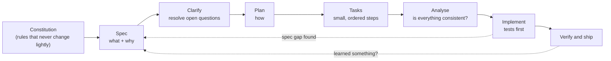

# How We Work: Spec-Driven Development

This page explains the working method: how an idea becomes a requirement, a plan, tasks and finally shipped, tested code. Every step leaves a written trace.

**The core rule:** the written spec is the source of truth. Code follows the spec, never the other way round. If the code needs to do something the spec doesn't say, update the spec first.

---

## 1. The flow in one picture



Each arrow is a **gate**: don't move on until the checklist for that step ([section 7](#7-checklists)) is complete.

## 2. Where things live

| What | File | Changes how often |
|---|---|---|
| Unbreakable rules | [docs/CONSTITUTION.md](CONSTITUTION.md) | Rarely, through an ADR |
| Shared vocabulary | [docs/GLOSSARY.md](GLOSSARY.md) | When a new term appears |
| What the whole product does | [docs/SPEC.md](SPEC.md) | When requirements change |
| How the whole product is built | [docs/PLAN.md](PLAN.md) + [docs/design/](design/) | When the design changes |
| The v1 checklist | [docs/TASKS.md](TASKS.md) | Daily (ticking boxes) |
| The API contract | [api/openapi.yaml](../api/openapi.yaml) | Before any API change |
| Decisions and their reasons | [docs/adr/](adr/) | When a significant decision is made |
| Features after v1 | `specs/NNN-name/` (spec, plan, tasks) | One folder per feature |
| Templates for all of the above | [docs/templates/](templates/) | Rarely |

**v1 versus later features:** v1 is planned as one big piece in `docs/SPEC.md`, `docs/PLAN.md` and `docs/TASKS.md`. After v1, each new feature or significant change gets its own folder in `specs/`, made from the templates. [specs/001-ci-feedback](../specs/001-ci-feedback/spec.md) is the first one, and a worked example of the method.

## 3. Adding a feature (after v1)

### Step 1: Specify (what and why)

1. Create `specs/NNN-short-name/` with the next free number.
2. Copy [spec-template.md](templates/spec-template.md) to `spec.md`. Fill in the problem, users, user stories with Given/When/Then scenarios, and requirements with new IDs.
3. Write **no technology** in the spec. "Send an alert when a test becomes flaky" is a requirement; "POST to a Slack webhook from a Spring `@Async` method" is a design.
4. Anything unclear gets a `[NEEDS CLARIFICATION: …]` marker. Don't guess.
5. Add the feature and its requirement IDs to the spec's list of features, and link it from [docs/SPEC.md](SPEC.md) if it changes the product's scope.

### Step 2: Clarify

1. Answer every `[NEEDS CLARIFICATION]`: research it, try it, or decide it.
2. Record each answer in the spec's **Clarifications** section, with the date.
3. **Gate:** the spec checklist ([section 7.1](#71-spec-is-ready)) passes.

### Step 3: Plan (how)

1. Copy [plan-template.md](templates/plan-template.md) to `plan.md`.
2. Fill in the **constitution check** first. If a rule must be broken, write it under *Complexity and exceptions* with a reason.
3. Design data changes, API changes (**edit `api/openapi.yaml` in this step**), the testing approach per requirement, risks, and spikes needed.
4. Write an ADR for any significant decision.
5. **Gate:** the plan checklist ([section 7.2](#72-plan-is-ready)) passes.

### Step 4: Tasks

1. Copy [tasks-template.md](templates/tasks-template.md) to `tasks.md`.
2. Break the plan into tasks of half a day or less, ordered so that **tests come before the code they test**.
3. Every task lists the requirement IDs it serves.
4. **Gate:** the tasks checklist ([section 7.3](#73-tasks-are-ready)) passes.

### Step 5: Analyse

Check that everything lines up before writing code:

- Run `node scripts/check-docs.mjs`. Every requirement has a task; no task points to a requirement that doesn't exist; no links are broken.
- Read the spec, plan and tasks side by side once. Does every acceptance scenario have a task that tests it? Does the plan contradict the constitution anywhere?

### Step 6: Implement

Work through `tasks.md` using the daily loop (next section).

### Step 7: Verify and ship

- Every acceptance scenario in the spec is demonstrated by an automated test.
- The Definition of Done ([section 7.4](#74-definition-of-done-for-every-pull-request)) holds for the final pull request.
- Set the spec's status to **Shipped**, and add a CHANGELOG entry.

## 4. The daily loop (one task)

1. **Pick** the next unticked task.
2. **Branch:** `t-1.14-idempotent-uploads`.
3. **Re-read** the requirement(s) the task lists, and the related plan section.
4. **Write a failing test** that proves the requirement. Name it after the ID:
   ```java
   @Test
   @DisplayName("FR-ING-004: identical re-upload returns the original upload")
   void identicalReuploadReturnsOriginal() { … }
   ```
   Run it. It must fail, and fail for the expected reason.
5. **Write the simplest code** that makes it pass.
6. **Refactor** while everything stays green.
7. **Run the local checks** (the commands will be listed in [AGENTS.md](../AGENTS.md) after Phase 0).
8. **Commit** with Conventional Commits and IDs:
   `feat(ingest): return original upload on identical retry (T-1.14, FR-ING-004)`
9. **Open a pull request** using the template. Tick the task in `TASKS.md` in the same pull request.
10. **Merge** when CI is green. Deployment happens automatically. Check that the smoke test passed.

Keep pull requests small: about 400 changed lines at most, not counting generated files and fixtures. If a task needs more, it should have been two tasks.

## 5. When things change

Requirements will change as you learn. That's normal. The rule is simply that **the documents change first**:

1. Edit the spec: change the requirement text, or add a new ID. **Never reuse or renumber an ID.** If a requirement is dropped, mark it `Withdrawn` with a date and leave the row in place.
2. Add a line to the spec's change log.
3. Update the plan, the contract and the tasks to match.
4. Then change the code and tests.

If you notice code already doing something the spec doesn't mention, that's drift. Either add it to the spec or remove it from the code.

## 6. Bugs

Every bug is one of two things:

- **The code doesn't do what the spec says.** Write a failing test named after the requirement ID, then fix the code.
- **The spec didn't cover this case.** Add or clarify a requirement first (with a new ID if needed), then test and fix.

Use the bug report template in `.github/ISSUE_TEMPLATE/`. A bug fix pull request always contains the test that reproduced the bug.

## 7. Checklists

### 7.1 Spec is ready

- [ ] The problem and the users are clear to someone new to the project.
- [ ] Every user story has Given/When/Then acceptance scenarios, including at least one failure or edge case.
- [ ] Every requirement has a unique ID and a milestone, and is testable: you can imagine the test.
- [ ] The spec names no technologies, frameworks or code structure.
- [ ] No `[NEEDS CLARIFICATION]` markers remain.
- [ ] *Out of scope* is written down.
- [ ] New terms are added to the glossary.

### 7.2 Plan is ready

- [ ] The constitution check table is complete, and any exception is justified.
- [ ] Every requirement maps to a design element *and* a test approach.
- [ ] API changes are already made in `api/openapi.yaml`, and it lints clean.
- [ ] Data changes are written as migrations that are safe during a deploy (old and new versions running at once).
- [ ] Security, observability and performance are covered (what could go wrong; what we log and measure).
- [ ] Significant decisions have ADRs.
- [ ] Risky unknowns have time-boxed spikes with fallbacks.

### 7.3 Tasks are ready

- [ ] Every requirement in the spec has at least one task.
- [ ] Every task lists requirement IDs, or is clearly a chore.
- [ ] Tests come before the code they test.
- [ ] No task is bigger than about half a day.
- [ ] `node scripts/check-docs.mjs` passes.

### 7.4 Definition of Done (for every pull request)

- [ ] Each behaviour change has a test that failed before the change, named with its requirement ID.
- [ ] CI is green: format, unit, integration, contract, architecture, coverage, mutation (if `core` changed), E2E and accessibility, security scans.
- [ ] `api/openapi.yaml` matches the API (if the API changed).
- [ ] Migrations are forward-only and safe during a deploy.
- [ ] New background behaviour has logs and metrics.
- [ ] Docs are updated where needed: spec status, plan, ADR, README, runbook, CHANGELOG.
- [ ] No `TODO` without a linked issue.
- [ ] The task is ticked in its tasks file.
- [ ] After merge: the deploy smoke test passed.

### 7.5 Release

- [ ] All tasks for the milestone are ticked, and its exit criteria are met.
- [ ] `node scripts/check-docs.mjs --strict` passes (for M2 and later).
- [ ] CHANGELOG has a section for the version, and the git tag matches.
- [ ] ADR statuses are up to date.
- [ ] The live demo shows recent data.

## 8. Traceability conventions

| Thing | Convention | Example |
|---|---|---|
| Requirement IDs | `FR-<AREA>-NNN` (functional), `NFR-<AREA>-NNN` (non-functional). Never reused. | `FR-ING-004`, `NFR-SEC-002` |
| Property IDs | `PROP-<AREA>-NN` | `PROP-DET-02` |
| Task IDs | `T-<phase>.<n>` for v1; `F<feature>-T<n>` for feature folders | `T-1.14`, `F001-T03` |
| Test names | Start with the ID in `@DisplayName` (Java) or the test title (TypeScript) | `"FR-ING-004: identical re-upload…"` |
| Branches | `t-<task>-<short-name>` | `t-1.14-idempotent-uploads` |
| Commits | Conventional Commits + task and requirement IDs | `fix(parser): keep retry order (T-1.8, FR-ING-007)` |
| Pull requests | The template asks for task IDs, requirement IDs and the DoD checklist | |

`scripts/check-docs.mjs` checks this automatically:

- **Default mode (from Phase 0):** every M1 and M2 requirement has a task; every referenced ID exists; every relative link and anchor in the docs works.
- **`--strict` (from M2):** additionally, every M1 and M2 requirement appears in at least one test file.

## 9. Working with AI coding assistants

AI assistants are welcome, but they work *inside* this process, not around it. The rules are in [AGENTS.md](../AGENTS.md). In short:

- The assistant reads the constitution, the relevant spec section and the task before writing code.
- It implements **one task at a time** and follows the daily loop, tests first.
- It may **propose** changes to the spec, plan, contract or constitution, but a human approves them. It never edits the constitution on its own.
- A human reviews every diff before merging. "The AI wrote it" is never a reason to skip a test or the Definition of Done.

## 10. Using GitHub Spec Kit (optional)

This setup follows the same ideas as [GitHub Spec Kit](https://github.com/github/spec-kit) (constitution → specify → clarify → plan → tasks → analyse → implement), but needs no tooling. To use Spec Kit's commands anyway:

| Spec Kit expects | Here |
|---|---|
| `.specify/memory/constitution.md` | Symlink or copy of `docs/CONSTITUTION.md` |
| `specs/NNN-feature/spec.md`, `plan.md`, `tasks.md` | Same layout in `specs/` |
| `.specify/templates/` | `docs/templates/` (copy the files across) |

Keep `docs/CONSTITUTION.md` as the original, so there is only one source of truth.
