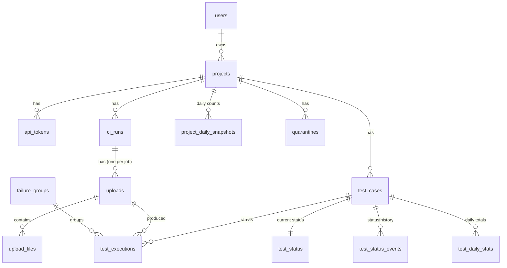

# Data Model

**Database:** PostgreSQL 17 · **Migrations:** Flyway, forward-only, in `server/src/main/resources/db/migration`

This is the reference schema. The real migrations should match it. If they need to differ, update this file in the same pull request.

---

## 1. Overview



The `jobs` table stands alone. It is the background work queue ([ADR-0003](../adr/0003-postgres-job-queue.md)).

## 2. Conventions

- **IDs:** `bigint generated always as identity`. URLs use project slugs; other IDs appear in URLs but every query checks access, so guessing an ID gets you nothing.
- **Times:** `timestamptz`, stored in UTC. **The application always writes times from its injected `Clock`.** Column defaults like `now()` exist only as a safety net. Queries that compare against "now" receive it as a parameter (`:now`), so tests can control time.
- **Enums:** `text` with a `CHECK` constraint. These are easier to evolve than PostgreSQL enum types.
- **Deletion:** deleting a project cascades to all its data (FR-PRJ-006).
- **Migration rules:**
  1. Never edit a migration that has run in production. Add a new one.
  2. Changes must work with both the old and the new app version during a deploy ("expand, then contract"). Example: add a nullable column, deploy, backfill, then add `NOT NULL` in a later migration.
  3. Every migration runs in CI against a real PostgreSQL (Testcontainers).

## 3. Tables

### Migration V1: users, projects, tokens (Phase 0)

```sql
create table users (
  id            bigint generated always as identity primary key,
  github_id     bigint      not null unique,
  login         text        not null,
  display_name  text,
  avatar_url    text,
  created_at    timestamptz not null default now(),
  last_login_at timestamptz
);

create table projects (
  id             bigint generated always as identity primary key,
  slug           text        not null unique
                 check (slug ~ '^[a-z0-9][a-z0-9-]{1,38}[a-z0-9]$'),   -- 3–40 chars
  name           text        not null check (char_length(name) between 1 and 80),
  owner_id       bigint      references users(id) on delete set null,  -- null for bootstrap projects (FR-PRJ-007)
  visibility     text        not null default 'PRIVATE'
                 check (visibility in ('PUBLIC', 'PRIVATE')),
  default_branch text        not null default 'main',
  settings       jsonb       not null default '{}'::jsonb,              -- detection settings overrides
  created_at     timestamptz not null default now()
);

create table api_tokens (
  id           bigint generated always as identity primary key,
  project_id   bigint      not null references projects(id) on delete cascade,
  name         text        not null check (char_length(name) between 1 and 60),
  scope        text        not null check (scope in ('INGEST', 'READ')),
  prefix       text        not null,          -- e.g. 'fw_ing_7Hq2' — safe to display
  token_hash   bytea       not null unique,   -- SHA-256 of the full token
  created_by   bigint      references users(id) on delete set null,
  created_at   timestamptz not null default now(),
  last_used_at timestamptz,                   -- updated at most every 5 minutes per token
  revoked_at   timestamptz
);
create index api_tokens_project_idx on api_tokens (project_id);
```

**Why SHA-256 and not bcrypt for tokens?** Tokens are 256-bit random values, not human passwords. Nobody can brute-force them, so a fast hash is safe. It also lets us find a token by its hash in one indexed lookup. ([ADR-0009](../adr/0009-authentication.md))

### Migration V2: runs, uploads, jobs (Phase 1)

```sql
create table ci_runs (
  id              bigint generated always as identity primary key,
  project_id      bigint      not null references projects(id) on delete cascade,
  provider        text        not null check (provider in ('GITHUB', 'JENKINS', 'GITLAB', 'OTHER')),
  external_run_id text        not null check (char_length(external_run_id) between 1 and 100),
  attempt         int         not null default 1 check (attempt >= 1),
  commit_sha      text        not null check (commit_sha ~ '^[0-9a-f]{7,64}$'),
  branch          text        not null check (char_length(branch) between 1 and 255),
  pull_request    int,
  repository_url  text,
  started_at      timestamptz not null,   -- from metadata; otherwise the first upload's received time
  created_at      timestamptz not null default now(),
  unique (project_id, provider, external_run_id, attempt)
);
create index ci_runs_project_started_idx on ci_runs (project_id, started_at desc);
create index ci_runs_project_commit_idx  on ci_runs (project_id, commit_sha);

create table uploads (
  id               bigint generated always as identity primary key,
  project_id       bigint      not null references projects(id) on delete cascade,
  run_id           bigint      not null references ci_runs(id) on delete cascade,
  job_key          text        not null default 'default' check (char_length(job_key) between 1 and 100),
  variant          text        not null default ''        check (char_length(variant) <= 100),
  content_sha256   bytea       not null,   -- hash over metadata + every file's hash, in a fixed order
  status           text        not null check (status in ('RECEIVED', 'PROCESSING', 'PROCESSED', 'FAILED')),
  file_count       int         not null check (file_count between 1 and 20),
  compressed_bytes bigint      not null,
  received_at      timestamptz not null,
  processed_at     timestamptz,
  error            text,                   -- why it FAILED, readable by the user
  warnings         jsonb       not null default '[]'::jsonb,
  summary          jsonb,                  -- {tests, passed, failed, errored, skipped, retried}
  unique (run_id, job_key)                 -- the idempotency key (FR-ING-004)
);
create index uploads_project_received_idx on uploads (project_id, received_at desc);

create table upload_files (
  id             bigint generated always as identity primary key,
  upload_id      bigint      not null references uploads(id) on delete cascade,
  file_name      text        not null,
  content_gzip   bytea,                    -- set to null by the 7-day purge (FR-ING-012)
  original_bytes bigint      not null,
  purged_at      timestamptz
);
create index upload_files_upload_idx on upload_files (upload_id);

create table jobs (
  id               bigint generated always as identity primary key,
  kind             text        not null,   -- PROCESS_UPLOAD, RECLASSIFY_TESTS, RECLASSIFY_AGING, PURGE_RAW_FILES, ...
  payload          jsonb       not null,
  dedupe_key       text,                   -- stops the same job being queued twice
  status           text        not null check (status in ('PENDING', 'RUNNING', 'DONE', 'DEAD')),
  attempts         int         not null default 0,
  max_attempts     int         not null default 5,
  run_after        timestamptz not null,
  lease_token      uuid,                   -- the fencing token
  lease_expires_at timestamptz,
  last_error       text,
  created_at       timestamptz not null,
  updated_at       timestamptz not null,
  finished_at      timestamptz
);
create index jobs_ready_idx  on jobs (run_after)        where status = 'PENDING';
create index jobs_lease_idx  on jobs (lease_expires_at) where status = 'RUNNING';
create unique index jobs_dedupe_uq on jobs (dedupe_key)
  where dedupe_key is not null and status in ('PENDING', 'RUNNING');
```

### Migration V3: tests, failures, executions, daily stats (Phase 1)

```sql
create extension if not exists pg_trgm;   -- fast "search by name" (FR-UI-002)

create table test_cases (
  id            bigint generated always as identity primary key,
  project_id    bigint      not null references projects(id) on delete cascade,
  key_hash      bytea       not null,      -- SHA-256 of test_key (keys can be very long)
  test_key      text        not null,      -- '<suite>#<name>'
  method_key    text        not null,      -- test_key without parameter suffix (quarantine level)
  suite         text        not null,
  name          text        not null,
  file          text,
  first_seen_at timestamptz not null,
  last_seen_at  timestamptz not null,
  unique (project_id, key_hash)
);
create index test_cases_project_method_idx on test_cases (project_id, method_key);
create index test_cases_key_trgm_idx       on test_cases using gin (test_key gin_trgm_ops);

create table failure_groups (
  id                 bigint generated always as identity primary key,
  project_id         bigint      not null references projects(id) on delete cascade,
  fingerprint        bytea       not null,
  failure_type       text        not null,
  normalized_message text        not null,
  sample_message     text        not null,     -- one original message, trimmed to 4 KB
  top_frames         text[]      not null default '{}',
  first_seen_at      timestamptz not null,
  last_seen_at       timestamptz not null,
  occurrences        bigint      not null default 0,   -- all-time; survives execution retention
  unique (project_id, fingerprint)
);

create table test_executions (
  id               bigint generated always as identity primary key,
  project_id       bigint      not null references projects(id) on delete cascade,
  test_case_id     bigint      not null references test_cases(id) on delete cascade,
  upload_id        bigint      not null references uploads(id) on delete cascade,
  run_id           bigint      not null references ci_runs(id) on delete cascade,
  execution_index  smallint    not null check (execution_index >= 0),
  is_final         boolean     not null,   -- last execution of this test in this upload
  status           text        not null check (status in ('PASSED', 'FAILED', 'ERRORED', 'SKIPPED')),
  quarantined      boolean     not null default false,   -- FR-ING-013
  duration_ms      int         not null default 0 check (duration_ms >= 0),
  executed_at      timestamptz not null,   -- copy of ci_runs.started_at, for fast time-range scans
  failure_group_id bigint      references failure_groups(id) on delete set null,
  failure_type     text,
  failure_message  text,                   -- trimmed to 4 KB
  stack_trace      text,                   -- trimmed to 16 KB
  unique (upload_id, test_case_id, execution_index)   -- makes reprocessing harmless (NFR-REL-002)
);
create index test_executions_case_time_idx    on test_executions (test_case_id, executed_at desc);
create index test_executions_run_idx          on test_executions (run_id);
create index test_executions_project_time_idx on test_executions (project_id, executed_at);

create table test_daily_stats (
  test_case_id      bigint  not null references test_cases(id) on delete cascade,
  project_id        bigint  not null references projects(id) on delete cascade,
  day               date    not null,
  default_branch    boolean not null,     -- whether the run was on the default branch at ingest time
  passed            int     not null default 0,
  failed            int     not null default 0,
  skipped           int     not null default 0,
  retried           int     not null default 0,
  total_duration_ms bigint  not null default 0,
  primary key (test_case_id, day, default_branch)
);
```

### Migration V4: statuses, history, snapshots (Phase 2)

```sql
create table test_status (
  test_case_id    bigint      primary key references test_cases(id) on delete cascade,
  project_id      bigint      not null references projects(id) on delete cascade,
  status          text        not null check (status in
                    ('STABLE', 'FLAKY', 'SUSPECTED', 'FAILING', 'BROKEN', 'NOT_ENOUGH_DATA')),
  status_since    timestamptz not null,
  by_variant      jsonb       not null default '{}'::jsonb,   -- {"": "STABLE", "firefox": "FLAKY"}
  evidence        jsonb       not null default '[]'::jsonb,   -- up to 5 most recent items
  impact          int         not null default 0,
  flip_rate       numeric(5,4) not null default 0,
  last_failure_at timestamptz,
  computed_at     timestamptz not null
);
create index test_status_project_status_idx on test_status (project_id, status, impact desc);

create table test_status_events (
  id           bigint generated always as identity primary key,
  project_id   bigint      not null references projects(id) on delete cascade,
  test_case_id bigint      not null references test_cases(id) on delete cascade,
  from_status  text,                       -- null for a brand-new test
  to_status    text        not null,
  reason       text        not null,       -- e.g. 'RETRY_PASS in run 9876543210'
  occurred_at  timestamptz not null
);
create index test_status_events_project_time_idx on test_status_events (project_id, occurred_at desc);

create table project_daily_snapshots (
  project_id      bigint not null references projects(id) on delete cascade,
  day             date   not null,
  stable          int    not null,
  flaky           int    not null,
  suspected       int    not null,
  failing         int    not null,
  broken          int    not null,
  not_enough_data int    not null,
  primary key (project_id, day)
);
```

### Migration V5: quarantine (Phase 6)

```sql
create table quarantines (
  id          bigint generated always as identity primary key,
  project_id  bigint      not null references projects(id) on delete cascade,
  method_key  text        not null,
  reason      text        not null check (char_length(reason) between 3 and 500),
  created_by  bigint      references users(id) on delete set null,
  created_at  timestamptz not null,
  released_at timestamptz,
  released_by bigint      references users(id) on delete set null
);
-- At most one active quarantine per method.
create unique index quarantines_active_uq on quarantines (project_id, method_key)
  where released_at is null;
```

## 4. Which transaction writes what

Keeping these boundaries is what makes the system correct ([Constitution Article 3](../CONSTITUTION.md#article-3-data-correctness-is-non-negotiable)).

| Step | One transaction contains | Guarantee |
|---|---|---|
| **Accept upload** (HTTP request) | Upsert `ci_runs` → insert `uploads` (or detect a duplicate) → insert `upload_files` → insert a `PROCESS_UPLOAD` job | Either the upload *and* its job exist, or neither does. No accepted upload can be orphaned. |
| **Process upload** (job) | Upsert `test_cases` → upsert `failure_groups` → insert `test_executions` (`on conflict do nothing`) → update `test_daily_stats` and `failure_groups.occurrences` **only for rows actually inserted** → set the upload to `PROCESSED` → queue `RECLASSIFY_TESTS` → mark the job `DONE` (checked by fencing token) | If a stale worker loses its lease, its whole transaction rolls back. If the job runs twice, the second run inserts nothing and counts nothing. |
| **Reclassify** (job) | Read executions → compute statuses (pure function) → upsert `test_status` → insert `test_status_events` for changes → mark job `DONE` | The status and its history always agree. |

## 5. Retention (NFR-DATA-001)

| Data | Kept for | Removed by |
|---|---|---|
| `upload_files.content_gzip` | 7 days | `PURGE_RAW_FILES` daily job (sets the column to null) |
| `test_executions` | 90 days | `PURGE_OLD_EXECUTIONS` daily job, in batches of 5,000 rows |
| `test_daily_stats` | 400 days | Same daily job |
| `jobs` rows that are `DONE` | 7 days | Same daily job (`DEAD` jobs are kept for 30 days for debugging) |
| Everything else | Until the project is deleted | Cascade on project delete |

## 6. Size estimate (NFR-COST-001)

| Source | Volume | Rows over 90 days | Approx. size |
|---|---|---|---|
| Demo repository | ~60 tests × 2 variants × 8 runs/day | ~86,000 executions | ~15 MB |
| Flakewatch's own CI | ~900 tests × ~10 runs/day | ~810,000 executions | ~150 MB |
| Raw files (7 days) | ~100 uploads/day × ~40 KB gzip | ~700 files | ~30 MB |
| Indexes and other tables | | | ~100 MB |
| **Total** | | | **~300 MB of the 1 GB free limit** |

Failure messages and stack traces are the largest per-row cost. That is why they are trimmed (4 KB and 16 KB) and stored only for failed executions.

## 7. Future options (not in v1)

- Partition `test_executions` by month if a project goes beyond ~10 million rows.
- Move raw files to object storage if uploads regularly exceed 50 MB per day ([ADR-0008](../adr/0008-raw-files-in-postgres.md)).
