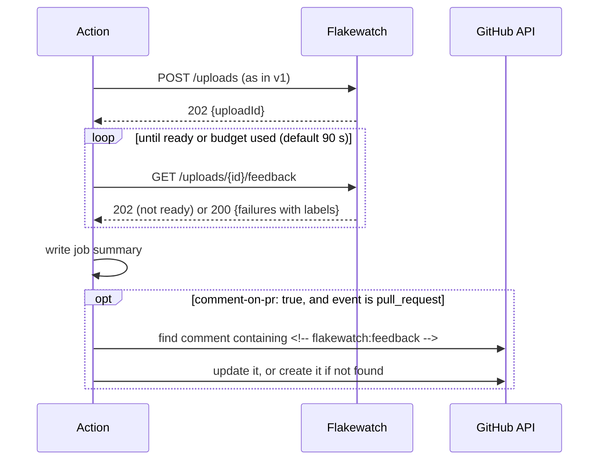
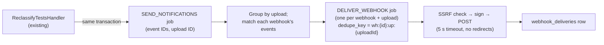

# Feature Plan: CI feedback

**Feature:** `001-ci-feedback` · **Spec:** [spec.md](spec.md) · **Status:** Approved
**Constitution version:** 1.0.0 · **Last updated:** 2026-11-13

---

## 1. Summary

Two independent parts:

1. **Action feedback:** after uploading, the Action polls a new `GET /uploads/{id}/feedback` endpoint until the labels are ready. It writes them to the job summary, and optionally creates or updates one PR comment through GitHub's API using the workflow's `GITHUB_TOKEN`.
2. **Webhooks:** status-change events, already recorded in v1, queue a `SEND_NOTIFICATIONS` job in the same transaction. That job groups the events per upload and creates one `DELIVER_WEBHOOK` job per matching webhook. Deliveries are signed, SSRF-checked and retried through the existing job queue.

## 2. Constitution check

| Rule | How this plan complies | ✅ / ❌ |
|---|---|---|
| P1 Evidence over verdicts | Messages and comments include the evidence line and link to it | ✅ |
| P2 Never break the user's build | Every feedback path in the Action is fail-open (FR-FBK-004) | ✅ |
| P3 Signal over noise | One updated comment; grouped alerts; only Flaky/Broken → Stable counts as "recovered" | ✅ |
| 1 Spec first, traceable | FR-FBK and NFR-FBK IDs in tasks and tests | ✅ |
| 2 Tests first | Tasks list tests first; grouping has a property test | ✅ |
| 3 Data correctness | Events → notification job in one transaction; deliveries idempotent per (webhook, upload) | ✅ |
| 4 Simple by default | Reuses the job queue; no broker; no GitHub App | ✅ |
| 5 Contract first | New operations added to `openapi.yaml` in task F001-T01 | ✅ |
| 6 Secure by default | HMAC signing; secrets encrypted at rest; SSRF checks at save and send time; https only | ✅ |
| 7 Deterministic | Signature timestamps from the injected `Clock`; known-vector HMAC test | ✅ |
| 8 Observable | Delivery metrics, delivery history, runbook entry | ✅ |
| 9 Small steps | 16 tasks, each half a day or less | ✅ |

## 3. Design

### 3.1 Action feedback



- **Ready means:** the upload is `PROCESSED`, and the `RECLASSIFY_TESTS` job it queued is `DONE`. Track this with a new `uploads.classified_at` column, set in the reclassification transaction.
- **New Action inputs:**
  - `wait-for-results` (default `false`; implied by `comment-on-pr`)
  - `comment-on-pr` (default `false`)
  - `feedback-timeout-seconds` (default `90`)
- **Permissions:** the workflow needs `pull-requests: write`. If the API returns `403`, log a notice and continue.

### 3.2 Webhooks



- **"Recovered"** is defined as Flaky or Broken → Stable (spec, Clarifications).
- **Message:**
  ```json
  {
    "text": ":warning: 2 tests became flaky in demo (run 9876543210): CartTest#addsItem, …",
    "project": "demo",
    "event": "became_flaky",
    "upload": { "id": 42, "runId": 7, "commitSha": "3f2a9c1" },
    "tests": [{ "testKey": "…", "from": "STABLE", "to": "FLAKY", "evidence": "…", "url": "…" }],
    "more": 0
  }
  ```
- **Signature headers:**
  - `X-Flakewatch-Timestamp: <unix seconds>`
  - `X-Flakewatch-Signature: sha256=<hex HMAC-SHA256(secret, timestamp + "." + body)>`

  Receivers should reject timestamps older than 5 minutes. The docs include verification code.
- **Secret storage:** the server must know the secret to sign with it, so it can't be hashed. Encrypt it with AES-GCM using `FLAKEWATCH_ENCRYPTION_KEY` (a new environment variable, 256-bit, base64). The secret is shown once on creation.
- **SSRF protection (NFR-FBK-001):**
  - When saving and before every send: only `https`; resolve DNS; refuse loopback, private (RFC 1918), link-local (including `169.254.169.254`), unique-local IPv6, `0.0.0.0/8` and multicast addresses.
  - Connect to the **resolved IP**, so the name can't be re-resolved between check and send.
  - First check whether Spring Boot 4.1's built-in HTTP client SSRF protection covers this. If it does, configure it and keep our tests.
- **Retries:** 6 attempts through the existing queue's backoff, capped so the total is about an hour.

## 4. Data changes

```sql
-- V6__ci_feedback.sql
alter table uploads add column classified_at timestamptz;   -- nullable: safe while old and new versions run

create table webhooks (
  id               bigint generated always as identity primary key,
  project_id       bigint      not null references projects(id) on delete cascade,
  url              text        not null check (url like 'https://%'),
  events           text[]      not null,               -- {'became_flaky','became_broken','recovered'}
  secret_encrypted bytea       not null,
  created_by       bigint      references users(id) on delete set null,
  created_at       timestamptz not null
);
create index webhooks_project_idx on webhooks (project_id);

create table webhook_deliveries (
  id           bigint generated always as identity primary key,
  webhook_id   bigint      not null references webhooks(id) on delete cascade,
  upload_id    bigint      references uploads(id) on delete set null,   -- null for test messages
  status       text        not null check (status in ('PENDING', 'SENT', 'FAILED')),
  attempts     int         not null default 0,
  last_status  int,
  last_error   text,
  created_at   timestamptz not null,
  finished_at  timestamptz
);
create index webhook_deliveries_webhook_idx on webhook_deliveries (webhook_id, created_at desc);
```

The limit of 3 webhooks per project is enforced in the service and covered by a test.

## 5. API changes

Added to `api/openapi.yaml` in F001-T01:

| Operation | Purpose | Callers |
|---|---|---|
| `GET /uploads/{id}/feedback` | `202` until ready; then `200 {failures: [{testKey, label, status, evidence, url}]}` | Ingest token (same project) |
| `GET /projects/{slug}/webhooks`, `POST`, `DELETE …/{id}` | Manage webhooks; `POST` returns the secret once | Owner |
| `POST /projects/{slug}/webhooks/{id}/test` | Send a test message | Owner |
| `GET /projects/{slug}/webhooks/{id}/deliveries` | Last 50 deliveries | Owner |

All new operations get authorization-matrix entries. The matrix test fails until they do.

## 6. Requirement → design → test

| Requirement | Design element | Tests |
|---|---|---|
| FR-FBK-001 | Feedback endpoint, `classified_at`, Action polling | `UploadFeedbackIT`; Action tests for polling and the summary |
| FR-FBK-002 | Comment upsert by marker | Action tests with a mocked GitHub API: create, then update |
| FR-FBK-003 | Ordering and caps in the Action's renderer | Snapshot tests of the rendered Markdown |
| FR-FBK-004 | Fail-open wrappers | Action tests: timeout, `403`, `500`, network error |
| FR-FBK-005 | `webhooks` table, API, limit of 3 | `WebhookApiIT`, matrix entries |
| FR-FBK-006 | Payload builder, HMAC signer | Known-vector HMAC test; payload contract test |
| FR-FBK-007 | `DELIVER_WEBHOOK` job, delivery history | `WebhookRetryIT` with a stub server returning `500` then `200` |
| FR-FBK-008 | Grouping per upload, dedupe key | Property: N changes in one upload → 1 delivery per matching webhook; `ReuploadSendsNothingIT` |
| FR-FBK-009 | Test endpoint | `WebhookApiIT` |
| NFR-FBK-001 | `SafeUrlValidator`, connect to the resolved IP | Table test of addresses; DNS-rebinding test with a fake resolver |
| NFR-FBK-002 | Wake on enqueue (existing) | Latency metric; check the demo data after a week |

## 7. Security, observability, performance

- **Threats:** SSRF (mitigated as above); leaked secrets (encrypted at rest, shown once, redacted from logs); spoofed messages (HMAC with timestamp); large responses (read at most 1 KB, 5 s timeout).
- **Metrics:** `flakewatch.webhooks.deliveries{outcome}` and `flakewatch.webhooks.delivery.latency`.
- **Logs:** `webhook.sent`, `webhook.failed`, `webhook.refused_ssrf`.
- **Runbook:** how to read the delivery history; how to rotate `FLAKEWATCH_ENCRYPTION_KEY` (re-encrypt secrets with a one-off command).
- **Performance:** negligible. At most 3 deliveries per upload per project.

## 8. Risks and spikes

| Risk or unknown | Spike / mitigation | Time box | Fallback |
|---|---|---|---|
| Does Spring Boot 4.1's SSRF protection cover DNS rebinding? | Read the docs, write a test with a fake resolver | 1 h | Our own `SafeUrlValidator` + connect by IP |
| PR comment API rate limits on busy repositories | One comment per PR, updated, not created | — | — |

## 9. Decisions

No new ADR is needed. This reuses ADR-0003 (job queue) and ADR-0009 (authentication). Encrypting webhook secrets with a key from the environment follows Constitution Article 6.

## 10. Complexity and exceptions

None.
